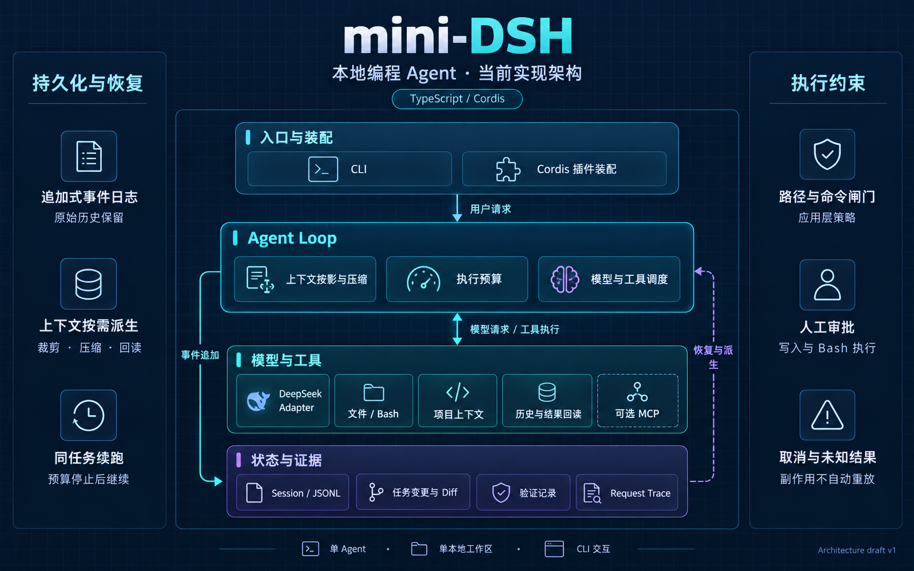

# mini-DSH

[](https://github.com/BeforeLanding/mini-DSH/actions/workflows/ci.yml)

mini-DSH 是一个 TypeScript / Cordis 编写的本地编程 Agent Harness。它把读项目规则、定位代码、可靠编辑、运行公开检查、交付 diff 与验证证据串成可恢复的任务流程；用事件日志、上下文投影、预算和工具审批说明每一步发生了什么。它面向单 Agent、单本地工作区，路径/命令闸门是应用策略，不是操作系统隔离。

仓库的教程基线来自[从零手写 mini-dsh](https://github.com/huangjunsen0406/mini-dsh/blob/main/LEARNING.zh-CN.md)，止于 `c5fc9c4`；`43e3829` 起是本项目的独立扩展。



## 五分钟上手

需要 Node.js ≥ 20.18.1、pnpm 11.22.0。Windows 的 Bash 工具使用 Git for Windows；Linux/macOS 使用 PATH 中的 `bash`。以下命令不需要 API key，不发出模型请求：

```powershell
pnpm install --frozen-lockfile
pnpm check
node dist/src/index.js --show-config
pnpm demo:compact
```

`--show-config` 只读装配同一个 Harness，输出**新会话**实际配置及来源（环境、`.env`、默认或 provider 容量），包括模型、布局、工具预览、预算和 `read_history`；不打印密钥、环境变量全集、项目规则正文，也不创建 CLI 会话。非法配置直接报错。若设置了 `MINI_DSH_SESSION_ID`，它拒绝把新会话配置冒充恢复会话的配置；恢复后用 CLI `/budget` 查看预算。`pnpm demo:compact` 使用脚本化模型演示单任务摘要、原始事件保留及 `read_history` 按事件号回读。完整离线回归可运行 `pnpm test`（会在本机执行 Bash 和文件工具）。

### 本地打包与安装

项目**尚未发布到 npm**。下面从当前仓库生成 tarball，在仓库外的临时目录安装；已在 Windows 的含空格路径验证 `mini-dsh.cmd`。依赖首次安装可能需要访问包注册表；CLI 的前三个命令无需 API key，也不会请求模型。

```powershell
$packRoot = Join-Path $env:TEMP ("mini-dsh-local-" + [guid]::NewGuid().ToString('N'))
$installRoot = Join-Path $packRoot 'consumer space'
$workspace = Join-Path $packRoot 'sample project'
New-Item -ItemType Directory -Path $packRoot, $installRoot, $workspace | Out-Null
pnpm pack --pack-destination $packRoot
pnpm --dir $installRoot add --ignore-scripts (Join-Path $packRoot 'mini-DSH-0.0.1.tgz')
$miniDsh = Join-Path $installRoot 'node_modules\.bin\mini-dsh.cmd'
Set-Location $workspace
& $miniDsh --help
& $miniDsh --version
& $miniDsh --show-config
```

### 只读检查会话日志

已有 `events.jsonl` 可在无 API key、无模型请求时查看。`inspect` 不恢复会话、不获取写锁，也不执行日志里的命令或工具；路径可以位于含空格的目录。

```powershell
$log = Join-Path $env:USERPROFILE '.mini-dsh\sessions\<session-id>\events.jsonl'
& $miniDsh inspect $log
& $miniDsh inspect $log --json
& $miniDsh inspect $log --trace
```

文本默认只列会话和最近一次 run 的状态、主请求/摘要请求/派发前拒绝、工具结果、provider token 与缓存、缺 usage、摘要及 `read_history` 次数、frozen 快照来源。`--trace` 只附带最近 40 条所选事件的序号、类型、工具名或终止原因；不显示提示正文和工具输出。`--json` 返回版本为 `1` 的结构化数据，含 `integrity.complete`、`integrity.warnings`，与 `--trace` 可组合。退出码：`0` 表示读到的 JSONL 全部通过校验，`2` 表示只能确认损坏/截断前的部分证据，`1` 表示参数或文件读取失败。`0` 不表示任务成功：没有 `run/finish` 时最近 run 为 `unrecorded_end`，生产日志没有独立产物验收。派发后缺 usage 计入未知请求数，不按零 token 补算；provider 输入 token 已包含缓存命中，不再重复相加，也不估算历史费用。会话结束时间没有独立事件时显示未记录，最近事件时间另列。旧日志反映当时的模型和代码，不代表当前配置。

要处理自己的项目时，先切换到**该项目目录**，再运行 `& $miniDsh` 启动交互；需要先在环境变量或该目录的 `.env` 设置 `DEEPSEEK_API_KEY`，实际对话可能产生费用。默认工作区是启动命令时的当前目录（可用 `MINI_DSH_WORKSPACE` 覆盖），`.env` 也只从当前目录读取，已有环境变量优先；安装包内不带 `.env`。会话默认存于用户主目录的 `.mini-dsh/sessions`（可用 `MINI_DSH_SESSION_DIR` 覆盖），超长工具结果存于工作区的 `.mini-dsh/tool-results`；这些用户数据不写入安装包目录。`/exit` 会释放会话写入锁。当前本地安装验收只覆盖 Windows，未据此声称其他平台的安装验证通过。

接入真实模型需先在 `.env` 填写 `DEEPSEEK_API_KEY`，再运行 `pnpm start`；**后续 CLI 对话可能产生模型费用**。不要覆盖已有 `.env`：

```powershell
if (-not (Test-Path .env)) { Copy-Item .env.example .env }
# 在 .env 中填写 DEEPSEEK_API_KEY
pnpm start
```

## 演示

上面的 `pnpm demo:compact` 是零付费机制演示：脚本化摘要缩小当前任务的请求投影，事件日志仍保留原文，并通过 `read_history` 回读。想看编辑、检查、失败后修复及交付证据的完整编程流程，可运行同样使用脚本化模型的 `pnpm demo:fix`。

面向招聘者的五分钟讲解顺序、工程贡献与取舍见[项目展示提纲](docs/RECRUITER_WALKTHROUGH.md)。

## 生产配置与 v2.1 对照

生产入口 [src/index.ts](src/index.ts) 调用共用的 [createHarness](src/app/create-harness.ts)，评测入口也调用它；没有另复制一套 Harness。日常默认是 `coding`、会话时钟 `frozen`、项目规则 `live`、16 KiB 工具结果预览，以及 [CLI_BUDGET](src/core/budget.ts) 的输入目标 65,536 token、主动压缩比例 0.8、一次溢出兜底、每段 2M 累计 token 上限。`read_history` 默认可用；它按事件号读取保留的原始历史，不是主动压缩开关。

- `MINI_DSH_CONTEXT_LAYOUT=live|frozen` 是旧版兼容入口；显式设置时同时控制运行时钟和项目上下文在系统提示里的文本是否固定。未设置时，项目上下文 `live`、运行时钟 `frozen`。它**不是**完整 Full 配置。
- `MINI_DSH_RUNTIME_TIME_MODE=live|frozen` 只控制运行时钟，优先于旧版布局对时钟的设置；默认 `frozen`。新会话有效值及来源可用 `--show-config` 核对。
- `MINI_DSH_TOOL_PREVIEW_BYTES` 控制有界工具结果进入模型历史的预览大小，默认 16,384 字节；超长结果可用 `read_tool_result` 回读。必须是正安全整数。
- `MINI_DSH_BUDGET` 沿用 CLI 的 JSON 预算配置，可调整输入目标、主动压缩、调用/工具/token/时间上限；`/budget` 查看当前会话的有效预算。溢出兜底与主动压缩是两条路径，关闭或推迟主动压缩不会自动关闭兜底。
- `MINI_DSH_PROFILE`、`MINI_DSH_WORKSPACE`、`MINI_DSH_PROJECT_DIRECTORY` 沿用既有配置；项目目录只决定初始规则上下文，不更改文件/Bash 工作区。

在冻结的 v2.1 开发协议中，Full 同时使用 frozen 前缀、65,536 输入目标的主动压缩和 16 KiB 有界预览；Baseline 使用 live 前缀、1M 输入/压缩目标和大预览（实现为 64 MiB 上限）。两臂都保留溢出兜底与 `read_history`，还共享模型、工具及整题预算。生产默认与任一实验臂均不能仅按 `contextLayout` 等同；[协议](docs/context-budget/NX-45-DEVELOPMENT.md)列出完整配置。

**frozen 会话与恢复：** `Time:` 和初始项目规则在该会话首次组装系统提示时取样，写入会话 JSONL；同一会话的后续轮次以及重启后用 `MINI_DSH_SESSION_ID` 恢复时复用原快照。同进程创建新的 sessionId 会重新取样；CLI 的 `/reset` 会清除可见历史，并在下次组装时重新取样。旧会话若没有保存快照、但已有模型请求，恢复时会明确提示：原始时间与规则无法还原，缺失部分按**当前**环境取样并标记为 `legacy-current`，不代表恢复了原快照。会话日志因此可能包含规则正文，应按工作区数据保护。

会话内 `AGENTS.md` 或项目配置变化不会自动修改 frozen 系统提示；`project_context` 工具读的是**当前磁盘内容**，可能与**本会话提示快照**不同。要让新规则进入系统提示，使用 `/reset`（丢弃可见历史）或启动新会话；仅恢复同一会话不会刷新。默认 live 在下一次组装时读取当前内容。没有全局热更新。新版本 frozen 日志增加两条快照事件，后续事件序号会变化；旧实验记录与严格回放规则未改，跨版本逐事件比较可能分歧。

## 实现入口

- [src/core/agent-loop-runtime.ts](src/core/agent-loop-runtime.ts)：请求投影、主动压缩和预算停止；[src/core/compaction-runtime.ts](src/core/compaction-runtime.ts)：摘要调用与结算。
- [src/core/session-runtime.ts](src/core/session-runtime.ts) 与 [src/core/event-store.ts](src/core/event-store.ts)：JSONL 事件、恢复和统计重建。
- [src/tools/files.ts](src/tools/files.ts)、[src/tools/bash.ts](src/tools/bash.ts)：有界读写、命令和验证证据；[src/plugins/tool-results.ts](src/plugins/tool-results.ts)、[src/plugins/read-history.ts](src/plugins/read-history.ts)：结果与历史回读。
- [src/models/deepseek.ts](src/models/deepseek.ts)：流式模型适配和 provider usage。配置入口在 [src/app/production-config.ts](src/app/production-config.ts)，无密钥查看在 [src/app/config-inspection.ts](src/app/config-inspection.ts)。

## NX-45 开发探索的边界

六道**已曝光开发题**、每臂计划分母 12、每题两次。Baseline/Full 的可靠完成为 **11/12 对 10/12**，独立产物验收为 **11/12 对 12/12**。Full 的峰时 provider usage 估价更低（$0.391956600 对 $1.448544408），但请求、工具调用和主动时间更多。费用是按指定历史价格重算的 usage 估价，**不是供应商账单**。本批没有证明可靠完成率提高、统计显著性或泛化优势；组合策略结果不能单独归因于稳定前缀或主动压缩。逐题结果、模型版本、固定预算和末尾轨迹见[探索报告](docs/context-budget/NX-45-EXPLORATION-RESULT.md)，源文件指纹、统计口径及原始证据的可访问边界见[公开证据摘要](docs/context-budget/NX-45-PUBLIC-EVIDENCE.md)。

更多设计与验收入口：[需求](docs/context-budget/REQUIREMENTS.md)、[计划](docs/context-budget/PLAN.md)、[任务清单](docs/context-budget/TASKS.md)、[进度](PROGRESS.md)。
