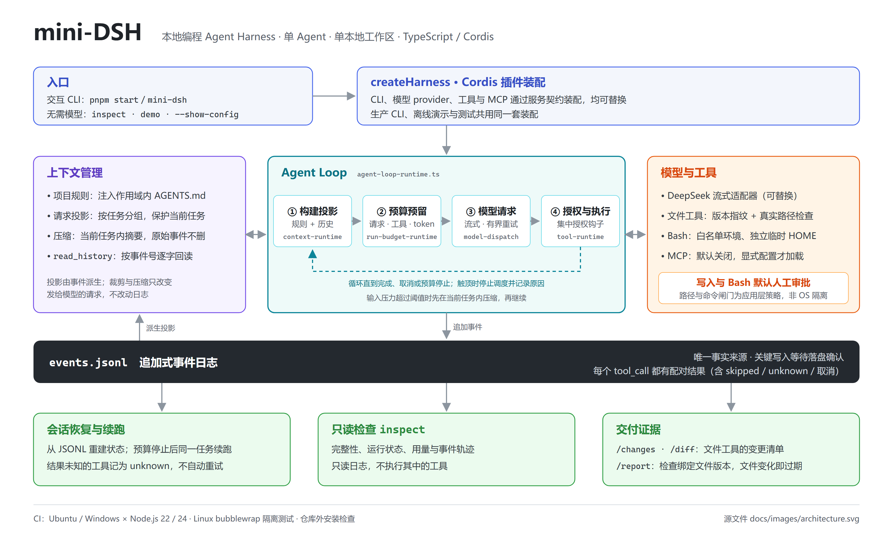

# mini-DSH

[](https://github.com/BeforeLanding/mini-DSH/actions/workflows/ci.yml)

> 在本地代码仓库中运行的命令行编程 Agent，让修改、检查和任务恢复有据可查。


用自然语言提出任务，让模型读取项目规则、定位代码、编辑文件并运行检查。你可以审批修改与命令执行，查看 diff 和验证记录，并在预算停止后继续任务。

mini-DSH 使用 TypeScript / Cordis 构建，内置 DeepSeek 适配器，适合希望在本地使用、理解或扩展编程 Agent 的开发者。主分支由一个 Agent 操作一个本地工作区。

[快速开始](#快速开始) · [日常使用](#日常使用) · [使用指南](docs/USAGE.md) · [架构](docs/ARCHITECTURE.md)

## 一次编程任务如何完成

启动 CLI 后，可以直接输入这样的任务：

> 修复项目中失败的测试。先阅读相关目录的 AGENTS.md，定位原因，修改代码并运行检查，最后说明改了什么、验证了什么。

任务流程：

1. **理解项目。** 读取项目规则和检查入口，搜索相关代码。
2. **审批操作。** 文件写入、编辑和 Bash 命令默认先征求你的批准。
3. **修改与验证。** 执行编辑和检查，根据失败输出继续修复。
4. **查看交付。** 用 `/diff` 查看文件工具修改，用 `/report` 查看检查结果、证据时效和未覆盖文件。

## 能帮你做什么

- **按项目约定工作。** 加载作用域内的 `AGENTS.md` 和项目检查入口，让模型在编辑前了解仓库规则。
- **检查每次修改。** 文件编辑使用版本指纹检测冲突；任务保留文件工具变更清单和 diff，便于复核。
- **保留验证依据。** 检查记录关联文件版本；之后文件变化会使证据过期，报告区分通过、失败、过期和未知。
- **管理长任务上下文。** 有界读取与搜索避免一次塞入全部内容，长输出可按引用回读；历史可裁剪、压缩，原始事件保留。
- **控制执行规模。** 配置模型请求、工具次数、主动时间和 token 预算；触顶时停止调度，并报告原因。
- **恢复与复查过程。** 会话持久化为 JSONL，可重建状态、继续符合条件的停止任务，也可在不请求模型时只读检查日志。结果未知的工具不会自动重跑。

## 快速开始

需要 **Node.js ≥ 22、pnpm 11.22.0 和 Bash**。Windows 使用 Git for Windows 自带的 Bash；Linux/macOS 使用 PATH 中的 `bash`。可从源码使用，也可安装 [v0.2.0 Release](https://github.com/BeforeLanding/mini-DSH/releases/tag/v0.2.0) 附带的 tarball（安装步骤见[使用指南](docs/USAGE.md#本地打包与安装)）；尚未发布到 npm。标为 `shell` 的命令在 PowerShell 与 bash 中相同；只适用于一种 shell 的写法分别给出。

### 1. 获取并构建

```shell
git clone https://github.com/BeforeLanding/mini-DSH.git
cd mini-DSH
pnpm install --frozen-lockfile
pnpm build
```

### 2. 先体验一次离线修复

```shell
node dist/src/index.js demo fix
```

演示在临时项目中运行“失败检查 → 读文件 → 修改 → 再检查”，结束时输出 `demo result: PASS`。它使用脚本化模型，无需 API key。

### 3. 接入真实模型

复制示例配置，已有 `.env` 会保留。PowerShell：

```powershell
if (-not (Test-Path .env)) { Copy-Item .env.example .env }
```

bash：

```bash
[ -f .env ] || cp .env.example .env
```

在 `.env` 填写 `DEEPSEEK_API_KEY`。默认工作区是启动目录；要操作自己的项目，再设置：

```dotenv
DEEPSEEK_API_KEY=your_api_key
MINI_DSH_MODEL=deepseek/deepseek-v4-flash
MINI_DSH_WORKSPACE=D:/path/to/your/project
```

将工作区路径换成实际项目路径；在仓库根目录运行：

```shell
pnpm start
```

看到 `User >` 后输入任务。写文件、编辑文件和执行 Bash 默认需要审批，按 Esc 可取消。真实模型调用会产生 API 费用。

## 日常使用

- **查看改动和检查：** `/changes` 查看文件清单，`/diff` 查看修改，`/report` 查看验证证据；大结果按提示翻页。
- **查看预算并继续：** `/budget` 查看额度与停止原因；预算停止后可用 `/continue` 尝试继续。已完成或工具结果未知的任务不能直接续跑。
- **管理上下文：** `/compact` 请求压缩历史，原始事件仍可回读；`/reset` 清除可见历史并保留原始日志。
- **切换与退出：** `/models` 查看模型，`/model provider/model` 切换；`/exit` 退出。

完整命令、预算配置、同一会话的重启恢复与日志检查见 [使用指南](docs/USAGE.md)。

## 演示

以下脚本用预设模型响应驱动真实的 Harness 路径，无需 API key：

- `pnpm demo:fix`：项目规则、定位、编辑、失败检查、再修复、diff 与验证证据。
- `pnpm demo:resume`：预算停止后在同一任务续跑。
- `pnpm demo:compact`：单任务压缩、原始事件保留与按事件号回读。
- `pnpm demo:unknown`：真实崩溃后的未知工具结果与陈旧锁处置。
- `pnpm demo:team`：可选只读委派（`MINI_DSH_DELEGATION=read-only`）：两个只读子 Agent 并发、共用任务组预算、无效结果与取消可见，只用预设响应。
- `pnpm demo:orchestrate-single`：只读 planner 判定单任务，一个 worker 在 worktree 中完成后由宿主整合并复验。
- `pnpm demo:orchestrate-parallel`：两个 worker 并行，第三个子任务在第二波次读取整合后的依赖产物。
- `pnpm demo:orchestrate-crash`：worker 运行中模拟崩溃，`resume` 采用已完成结果、确认未知用量并为未知副作用要求人工决定。

后三个演示属于多 Agent 编排，当前在开发分支、尚未合入 main；见下方的[多 Agent 编排](#多-agent-编排开发分支待评审合并)。

## 多 Agent 编排（开发分支，待评审合并）

当前 main 尚未包含编排入口。M1–M4 的代码与证据在 `feat/orchestration-m*` 分支；领域契约见 [DEVELOPMENT.md](docs/superagent/DEVELOPMENT.md)，逐项命令与证据见 [CHANGES.md](docs/superagent/CHANGES.md)。

在同一根任务内，宿主校验计划 → 每个 worker 一个独立 Harness + git worktree → 宿主提交、写集检查、按序 cherry-pick 整合 → 整合后复验（证据绑定 tree SHA）。单 Agent 与只读委派的既有行为不变。

```bash
# 在目标仓库内运行；省略 --plan 时由只读 planner 提出计划
mini-dsh orchestrate run --task "..." [--plan plan.json] [--max-workers 2]
mini-dsh orchestrate inspect <rootId>
mini-dsh orchestrate resume <rootId> [--accept-unknown-usage] [--retry <subtaskId>]...
```

- **审批（D8）：** worktree 内的 `write_file`/`edit_file` 默认自动批准；Bash 默认询问，所有请求经单一 FIFO 队列逐条显示；`--approve-writes ask` 恢复逐条写入审批。
- **停止：** 第一次 Ctrl-C 停止派发并整合已完成部分；第二次 Ctrl-C 中止运行中的 worker，根任务取消。
- **恢复：** `resume` 采用已完成的 worker 结果而不重跑；未知副作用、冲突与崩溃留下的未知用量需要人工决定或确认。
- **离线装配：** `pnpm eval:orchestrate --validate-only` 校验组合夹具与四臂矩阵（S / D / R / R-serial），不发起任何 provider 请求。真实模型批次需单独授权，尚未执行。

## 当前状态

已发布 [v0.2.0](https://github.com/BeforeLanding/mini-DSH/releases/tag/v0.2.0)。已实现源码 CLI、本地 tarball 安装、DeepSeek 适配器、文件/Bash 工具、上下文与预算管理、持久化恢复和只读日志检查。CI 覆盖 Ubuntu / Windows × Node.js 22 / 24，并包含 Linux bubblewrap 隔离测试和仓库外安装检查。

### 已知边界

- **权限：** 路径与命令闸门是应用层策略，不是操作系统隔离；Bash 与显式信任的 MCP server 可访问当前用户有权限的文件。MCP 默认不加载 server。
- **改动追踪：** `/diff` 覆盖文件工具的修改；Bash 与外部程序的改动请结合 Git 查看。
- **恢复：** 重建事件状态，不还原文件快照；结果未知的工具需人工核验，不自动重试。
- **预算：** token 为估算值，执行预算不等于费用硬上限；`/compact` 可能请求模型。
- **验收：** 任务能否完成取决于模型与项目；`/report` 记录检查证据，验收仍由使用者判断。
- **发布：** 以 GitHub Release 提供 tarball，尚未发布 npm；macOS 安装未验证。ECS 部署仅保留[手动入口](docs/ECS_DEPLOYMENT.md)。
- **范围：** 演示与离线回归验证的是机制；模型评测只有下面的 SWE-bench 对照一项，其运行器与完整过程在[实验分支](https://github.com/BeforeLanding/mini-DSH/tree/improve/swe-harness-advantage-20261031)。只读委派（默认关闭）已在 main；项目记忆仍只在 [feat/memory-team-eval-v2](https://github.com/BeforeLanding/mini-DSH/tree/feat/memory-team-eval-v2)，不属于 main 交付范围。多 Agent 编排的 M1–M4 在开发分支，尚未合并；其真实模型四臂对照未执行，目前只有离线装配与机制演示。

## 评测

在 90 道未参与调参的 SWE-bench Verified 题上，打开长单任务组件的 mini-DSH 解决 74 题；同模型（`deepseek/deepseek-flash`）、同环境、同 token 上限下，mini-SWE-agent 解决 57 题，同源码但不开组件的 mini-DSH 解决 61 题。代价是成本约为 mini-SWE-agent 的 2.6 倍；没有做逐项消融，差距不能归给单个组件。这些组件在 main 上默认关闭，开关见[使用指南](docs/USAGE.md#长单任务的可选组件)。设置、配对检验与限制见 [SWE-bench 结果](docs/SWE-BENCH-RESULTS.md)。

多 Agent 编排另有一套离线评测装配（组合夹具 × S/D/R/R-serial 四臂）：`pnpm eval:orchestrate --validate-only`。它只校验验收器正反例与矩阵公平性，provider 请求为 0；真实模型小批次需要单独授权，尚无结果可报告。

## 架构与扩展



CLI、模型、工具与 MCP 通过 Cordis 插件和服务契约装配；生产入口与评测入口共用 `createHarness`。JSONL 记录会话事实，上下文投影与统计从事件派生；裁剪和压缩保留原始事件。

### 实现入口

```text
mini-DSH/
├── src/
│   ├── index.ts       # CLI 启动入口
│   ├── app/           # Harness 装配、生产配置、MCP 配置与离线演示
│   ├── core/          # Agent Loop、事件日志、会话恢复、上下文与预算
│   ├── plugins/       # 将运行能力注册为 Cordis 服务，接入 CLI、记忆与协作
│   ├── models/        # 模型适配器：当前内置 DeepSeek 流式协议
│   ├── tools/         # 文件读写、搜索、Bash 与任务变更/验证报告
│   └── utils/         # 通用辅助函数
├── plugins.config.ts  # 插件装配配置
├── scripts/           # 构建、演示、评测与证据复算入口
├── test/              # 核心与集成回归、编程任务夹具
└── docs/              # 使用指南、架构设计与开发证据
```

从 [src/index.ts](src/index.ts) 进入，由 [create-harness.ts](src/app/create-harness.ts) 装配服务；[Agent Loop](src/core/agent-loop-runtime.ts) 协调模型请求、上下文、预算与工具执行，过程写入事件日志，供会话恢复和只读检查使用。

详细设计见 [架构说明](docs/ARCHITECTURE.md)、[设计取舍](docs/context-budget/DECISIONS.md)和[工程案例](docs/CASES.md)。

## 开发与文档

```shell
pnpm check
pnpm test
```

`pnpm check` 执行 strict 类型检查、构建和产物语法检查；`pnpm test` 运行核心与 Cordis 集成回归，无需模型密钥，集成测试实际执行 Bash。修改前阅读 [AGENTS.md](AGENTS.md)。

- [五分钟项目讲解](docs/RECRUITER_WALKTHROUGH.md)：演示顺序与工程取舍。
- [使用指南](docs/USAGE.md)：命令、预算、恢复、配置来源与本地打包安装。
- [文档索引](docs/README.md)：设计文档、验收记录与开发档案。

## 来源与许可

教程基线来自[从零手写 mini-dsh](https://github.com/huangjunsen0406/mini-dsh/blob/main/LEARNING.zh-CN.md)，止于 `c5fc9c4`；`43e3829` 起为本项目独立扩展。许可证与来源说明见 [LICENSE](LICENSE) 和 [NOTICE](NOTICE)。
