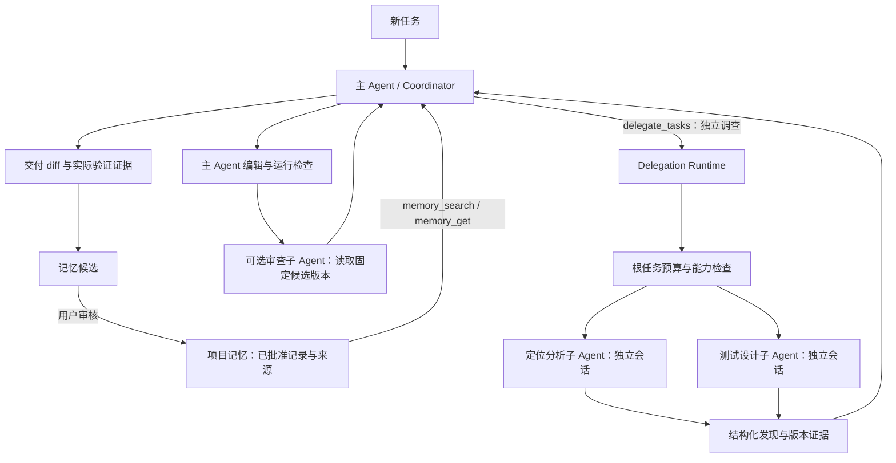

# mini-DSH：项目记忆与 Multi-Agent 落地方案

状态：设计提案，尚未实现。日期：2026-10-22。

本地基线：`D:\Agent\mini-DSH-execution`，`main@309af44f239bc42307b2ba99aec9f89d5556cbb2`，检查时工作区干净。GitHub 远端 `main` 仍为 `74f8e89721820ef514e26df71cbb05e0c69683c7`。本方案读取了本地新增的外部基线/共享 token 上限状态，不沿用上一轮“本地外部适配器尚未实现”的判断。

本次只制定可实施的设计，未修改项目源码、未运行模型或新评测。本地进度中已有一次四臂开发观察，但预算口径随后改变；它不构成新增记忆或多 Agent 的效果证据。

## 1. 产品目标与首版范围

围绕一个场景交付：**用户在同一代码仓库分多次处理问题；Agent 能复用可核验的项目经验，在复杂问题上并行调查，最终由一个主 Agent 修改代码并验证。**

首版目标：

1. 跨会话找到该项目已经确认的模块事实、验证方法和相关任务经验，并展示来源与失效条件。
2. 主 Agent 可以把独立调查任务交给最多两个并行只读子 Agent，获得有界、结构化、带版本证据的结果。
3. 根任务统一限制模型请求、工具调用、token 和总时限；子 Agent、摘要与重试不能获得独立于根任务的额外额度。
4. 父子关系、预算与结果能从事件恢复；中断后不自动重复发模型请求或重放未知工具副作用。
5. 通过同预算消融与公开轨迹判断功能是否值得默认开启。

首版不包含：向量数据库、全局用户画像、递归 Agent Swarm、任意 DAG 工作流编辑器、多个 Agent 共享目录写代码、后台无限反思、自主执行记忆里的命令。检索接口保留扩展点；只有词法检索的实测失败说明需要时，再引入 embedding/reranker。

现有路线图将多 Agent 和向量记忆列为暂缓项。当前用户请求扩展设计范围；实施时应同步 REQUIREMENTS/PLAN/ROADMAP 的新阶段，保留旧阶段的历史结论，不需要先迁移到 LangGraph。

## 2. 当前能力与新增能力的边界

### 已有，可复用

- `src/core/session-runtime.ts` / `event-store.ts`：单会话 JSONL、恢复、写锁、unknown/skipped、终态确认。
- `context-runtime.ts` / `compaction-runtime.ts` / `history-read.ts`：工作上下文、压缩及本会话回读。
- `AgentRuntime.create()`：可创建多个 Agent 对象；尚不包含协作调度。
- `createHarness()`：模型适配、commandRunner、工具及 Cordis 生命周期。
- `ToolRuntime` / `tool-authorization.ts`：中央执行和授权边界。
- `RunBudgetRuntime`：每次 run 的预算、取消与审批计时。
- `task-verification.ts`：检查与候选文件版本的关联。

### 本阶段新增

- 项目级长期记忆存储、来源验证、检索、候选审核和撤销。
- 角色能力白名单与适配受限工具集的提示。
- 根任务预算协调器、请求预留/结算账本与并发准入。
- 有父子关系的独立会话、批次分工工具、结果制品及恢复协调。

已有 JSONL 是过程事实；压缩摘要是当前任务的上下文；长期记忆是经过筛选、具有失效条件的跨会话知识。分工状态属于当前根任务，不能自动进入长期记忆。

## 3. 组合架构与执行流程



执行采用阶段屏障：调查期间主 Agent 等待；调查完成后由主 Agent 编辑；审查期间固定候选版本并停止自身写入。用户或外部进程仍可能改文件，所以每条发现附带文件指纹，主 Agent 使用前重新核验。

首版的并行化发生在 `delegate_tasks` 内部，不把既有通用工具循环改成并发执行。文件写入、Bash 与审批继续走既有顺序和复核。

## 4. 项目记忆详细设计

### 4.1 记什么

- **项目事实 project_fact**：模块职责、入口路径、接口约束。必须有相应文件/规则的版本锚点。
- **验证方法 procedure**：某类改动对应的检查命令、环境前提、已知限制。命令是历史经验，执行仍需正常审批和当前证据。
- **任务经验 episode**：相关问题、关键发现、曾失败的尝试与解决线索，指向任务证据；不能把过去成功当成当前结论。

AGENTS.md 和当前用户明确要求继续是规则来源。长期记忆不覆盖它们；不自动把检索到的自由文本提升为系统指令。任务 `completed`、测试退出码 0 或模型自述均不能单独触发“经验已证实”。

### 4.2 数据契约

以下是拟新增接口，不是现有 API：

```ts
type MemoryKind = 'project_fact' | 'procedure' | 'episode'

interface SourceRef {
  sessionId: string
  taskId: string
  eventId: string
  seq: number
  artifactSha256?: string
}

interface MemoryAnchor {
  path: string                 // 项目相对路径
  contentSha256: string
}

interface MemoryRecord {
  id: string
  projectId: string
  revision: number
  kind: MemoryKind
  key: string                 // 规范化去重键
  title: string
  content: string
  tags: string[]
  state: 'candidate' | 'approved' | 'superseded' | 'revoked'
  sources: SourceRef[]
  anchors: MemoryAnchor[]
  createdAt: string
  approvedAt?: string
  expiresAt?: string
  supersedes?: { id: string; revision: number }
}
```

“过期/证据不可达/文件已变”是查询时派生的有效性状态，不能依赖模型填写的 confidence 数字。哈希可证明所引用版本的身份，不能单独证明内容正确。

审批对象绑定候选 id、revision 与内容摘要。候选变更后旧批准失效。更新采用 expectedRevision 比较；不按最后一次写入静默覆盖矛盾记录。

### 4.3 存储与项目隔离

首版复用 JSONL 思路，新增独立 MemoryStore 接口：

```text
~/.mini-dsh/memory/<projectId>/events.jsonl     # 记忆事实来源
~/.mini-dsh/memory/<projectId>/writer.lock
~/.mini-dsh/memory/<projectId>/index.json       # 可删除、可重建
~/.mini-dsh/memory/<projectId>/sources/         # 最小可核验来源制品
```

- 默认 projectId 由规范化真实工作区路径计算，不仅凭 Git remote URL 自动共享。克隆副本与其他项目默认隔离。
- 如需跨 worktree 共用，用户显式绑定已有 projectId；查询仍按文件锚点与分支/基线信息过滤。子 Agent 的项目绑定由宿主传入，模型不能任意指定项目。
- 单个项目一个写入者；同进程由队列串行写，多进程锁冲突时可降级只读。子 Agent 只读冻结视图。
- `opId` 去重、单调 seq、追加后 sync、尾部损坏隔离、运行时 schema 校验。记忆存储不直接复用带 SessionEvent 固定词表的解析器。
- 记忆日志是记忆变更的事实来源，会话事件只记录提案/查询/操作 receipt；两者用 opId 关联。恢复先查已落盘 receipt，不能因会话 receipt 缺失再次写入同一候选。
- 默认建议：最多 2,000 条活动记录、单条内容 2 KiB、journal 32 MiB。均可配置；达到限制后停止新增候选并提示维护，不悄悄删除历史。

首版不引入 SQLite 原生依赖。以后性能数据证明需要时，可替换索引或后端；不改变对外的来源、版本与失效契约。

### 4.4 写入流程

1. 主 Agent 在当前 run 中通过 `memory_propose` 提交至多三条候选，附可核验来源；这仍是普通工具调用并计入预算。
2. 宿主校验项目、长度、来源是否为本任务允许访问的已确认事件、文件锚点及敏感内容边界。
3. 候选只进入 candidate 区，不参与普通检索。CLI `/memory review` 显示内容、来源与当前有效性。
4. 用户执行 `/memory approve <id> <revision>` 后才进入 approved；模型工具集中不提供 approve。
5. 新版本替代、撤销均追加事件；冲突候选保留冲突信息，等待审核。

没有后台 LLM 反思或无预算抽取。后续可增加显式 `/memory extract <task>`：它是独立维护 run，有可见预算和模型用途；费用在工作流报告中另列并计入总成本，不能隐匿在任务结束后。

来源提取只处理被选中的最小材料，不自动扫 `.env`、密钥、完整环境、原始用户目录或隐藏评分器。规则过滤不是完整的数据防泄漏保证，首版保留审核，并使用公开测试数据演示。

### 4.5 检索与上下文接入

首版采用工具式、按需检索：`memory_search` → `memory_get`。system 中只放固定的使用说明；不每轮拼入不断变化的全量记忆，不替换现有 frozen 时间/规则快照。

顺序：项目作用域过滤 → 记录状态/TTL → 来源可达与文件锚点 → 标识符/路径/关键词检索 → 确定性排序 → 数量及 token/字节裁剪。英文标识符切分，中文可先用二元词元；排序同分按固定 id 结束，便于离线复算。检索实现留 `MemoryRetriever` 接口，embedding 不进入第一版。

新逻辑任务创建 MemoryView，固定可见候选集合与已批准版本；子 Agent 继承同一 MemoryView 的允许子集。每次查询仍剔除已撤销、已过期或锚点不符的记录，记录过滤理由；不会在同任务中悄悄加入新批准内容。新任务才能刷新集合。

每次工具结果记录 memory id/revision、来源、有效性与 query digest；正文随普通 tool/result 保存。回放读取当时结果，不访问今天的记忆索引重跑检索。来源解析器按原日志 eventId/seq 读取，不能只调用 `visibleEvents`：reset 之前的已确认原事件可能已不在可见历史。

建议初始上限：每次最多 5 条、总返回估算 2,048 token、8 KiB；正文、来源标注及协议包装都计入额度。记忆结果进入既有请求估算及压缩路径，不能成为预算外的附加段。`memory_get` 同样有界。

`/memory forget` 代表撤销检索资格，不能声称物理擦除了 JSONL 或已经发给模型的内容。已进入活动上下文的信息无法收回；撤销应追加可见失效提示，后续读取拒绝返回，并建议在新任务刷新视图。物理 purge 属于后续独立维护功能，需一并处理索引、来源副本与相关保留策略。

## 5. Multi-Agent 详细设计

### 5.1 角色及能力

- **Coordinator**：普通编程 Agent，拥有现有编辑、Bash、验证、报告能力；可发起分工；它是工作区唯一 Agent 写入者。
- **Analyst**：代码定位、接口调查、相关模块分析；只读文件、glob/grep、项目规则、受限记忆。
- **Test designer**：输出需要覆盖的行为与反例、建议测试位置；不执行 Bash，不声称测试已经通过。
- **Reviewer**：读取固定候选 diff 与相关文件，输出具体问题和证据；不修改文件，不替代独立检查。

先实现 Analyst/Test designer，Reviewer 作为同一只读机制的后续行为扩展。所有子角色禁止 write_file/edit_file/Bash/MCP/再次委派/记忆批准或写入。测试程序可能产生写入，不能因名字叫测试就交给“只读”子 Agent。

能力约束需要双层实现：createHarness 只注册允许的工具；ToolRuntime.execute 再检查不可变的角色能力白名单。不能仅依赖 tool.effect 自报为 read，也不能只靠提示词。

当前 coding profile 的提示明确要求 task_report/task_changes；受限子 Agent 可能没有这些工具。因此增加 `agentRole` 对应的提示模板，按实际工具能力渲染，不直接复用完整 codingIdentity。能力限制本身属于应用层；实际工作区和网络隔离继续复用已验证后端。

### 5.2 单一分工工具与子任务契约

首版只增加一个同步批次工具 `delegate_tasks`，模型通过一次调用提出多个独立子任务，宿主校验后并行执行并等待收敛。父模型在等待期间不继续推理；通用工具循环保持串行。

```ts
interface DelegateTaskInput {
  role: 'analyst' | 'test_designer' | 'reviewer'
  objective: string
  contextRefs: string[]       // 宿主签发的项目内证据引用
  outputFocus: string
}

interface AgentFinding {
  kind: 'observation' | 'hypothesis' | 'recommendation'
  text: string
  evidence: Array<{ path: string; contentSha256: string; line?: number }>
}

interface DelegationResult {
  delegationId: string
  childSessionId: string
  status: 'completed' | 'failed' | 'cancelled' | 'interrupted' | 'invalid_result'
  findings: AgentFinding[]
  unresolved: string[]
  resultRef: string
  resultSha256: string
}
```

宿主产生 groupId/delegationId/childSessionId，绑定 parentSessionId、parentTaskId、parentRunId、parentToolCallId 和批次内索引。不得依赖模型自报 id 去重，也不得用模型提供的路径读取任意会话日志。

每个子 Agent 都有独立 Context/Session/SystemPrompt/ToolRuntime 和日志；通过受控配置共享预算服务和记忆只读视图。直接在同一个 root 上创建多个 Agent 仍共享工具/系统提示，不能实现角色隔离。

子任务只接收目标、必要规则、引用与有界文件片段，不复制父会话全部历史。结果必须通过运行时校验；全文保存为独立制品，父会话只接收有界摘要与 ref。初始建议结果 1,536 估算 token / 8 KiB，二者同时满足；超大或非法结果标记 invalid_result，不能静默当成完整成功。最小来源路径与 hash 由宿主复核。

整批回传再设 4,096 估算 token / 16 KiB 上限，包含全部 child 的状态与制品引用。超出时缩短摘要视图并明确标记，完整合法结果保存在制品中。现有 `read_tool_result` 校验 session owner，不能直接把 child 的 ref 交给父 Agent；需由宿主校验结果后，通过 ToolResultStore 的受控发布接口保存为父会话拥有的结果副本，再使用现有回读工具。不能为协作关闭 owner 校验。

开启 delegation 配置表示允许在已配置额度和角色范围内分工；中央授权登记内置 `delegate` 效果后由能力/预算守门，不为每个只读 child 重复询问。对文件写入、Bash、未知第三方工具的既有审批不作放宽。开启 memory assist 只允许有限候选写入，长期批准仍来自用户命令。

主 Agent 对关键发现重新读取当前文件；候选已变则 reviewer 结论标 stale。不同子 Agent 相互同意不等于验证通过，主 Agent 仍运行公开检查并使用现有版本化验证记录。

### 5.3 初始可配置额度

以下是首版建议值，必须写进配置/`--show-config`，不是已经实现的默认值：

```ts
{
  memory: { mode: 'off', maxItems: 5, maxRecallTokens: 2048, maxRecallBytes: 8192 },
  delegation: {
    mode: 'off', maxConcurrent: 2, maxChildrenPerTask: 4, maxDepth: 1,
    childMaxModelRequests: 8, childMaxToolCalls: 16,
    childMaxTotalTokens: 200_000,
    maxResultTokens: 1536, maxResultBytes: 8192,
    maxBatchResultTokens: 4096, maxBatchResultBytes: 16384
  },
  taskGroupBudget: {
    maxModelRequests: 64, maxToolCalls: 128, maxTotalTokens: 2_000_000,
    rootTokenFloor: 1_000_000, rootRequestFloor: 32,
    maxWallDurationMs: 900_000
  }
}
```

按需显式打开 memory/team。`maxChildrenPerTask=4` 是整个逻辑任务的累计上限，不是每次 delegate 都重新获得 4 个。深度 1 表示只有根 Agent 可以创建子 Agent。各子任务上限也受整个 children pool 剩余额度限制。

根任务总 wall time 与现有 run active time 分开显示：前者包含等待、审批及重启间隔；后者继续按现有审批暂停语义计算。wall deadline 持久化，恢复不会刷新；需要延长时必须形成显式配置变更事件。所有数值可调，不隐藏新增固定轮数限制。

### 5.4 根任务预算协调器

当前 `RunBudgetRuntime` 约束单 run；`ModelNotDispatchedError` 是拒绝类型，不能直接当作已有全局调度器。新增 `TaskGroupBudgetCoordinator`，统一包住实际 LlmRuntime/adapter 派发与所有角色工具准入。

必须覆盖 root/child 的 main、summary、重试；以后任何 memory extraction 也使用明确的调度作用域。显式传递 `{ groupId, agentId, sessionId, runId, requestId, purpose }`，不靠全局“当前 Agent”变量。`CompactionAttempt` 也需要传递它。

请求流程：

1. 使用包含工具 schema、记忆与包装的完整请求估算输入，计算 `reserve = inputEstimate + safetyMargin + maxOutputTokens`。
2. 串行准入队列原子检查 `settled + outstandingReservations + reserve <= groupCap`，同时检查请求配额与 root floor。校验、写预留、更新可用量必须在同一串行区间，不能先 await 后扣减。
3. 预留与 dispatch intent 落盘确认后才调用 provider。确知未派发的拒绝可以释放；已经派发但结果未知的请求不能当作没花钱。
4. provider usage 通过校验后，按 requestId 一次性结算并释放预留差额；重复 usage 不重复扣费。每次重试是新的 requestId、独立准入与结算。
5. usage 缺失/派发后崩溃时保留未决预留并暂停新的组内派发，标记 usage_unknown，不能填零或用 estimated usage 结清真实成本。

root floor 保留给编辑、验证与最终交付，避免子任务耗尽全部额度。worker admission 不能侵占尚未使用的 floor；root 自己的已结算与预留会相应消耗 floor。首版可按固定 root/children 子额度实现，不自动借用；以后若借用，须通过可重放的 transfer 事件。

token 预留依赖估算，不能宣称绝对不会超过 provider 真实 token 上限。实际 usage 超过预留时记录 overrun、停止准入并取消可取消请求。请求/工具次数能严格守门；token/金额还需要披露估算误差、在途暴露与未知用量。只读检索虽不发模型，也计工具调用并限制结果大小。

`delegate_tasks` 外层工具计一次，子 Agent 实际工具调用各计一次；子任务结果制品读取也计一次。root 汇总是唯一全组账目，不能把 root 汇总数与 child 统计再次相加。使 root 的现有单 run 计数与新增 group 计数分别可见。

### 5.5 持久化与恢复

继续用原会话 JSONL：根会话记录分工与预算事件，各子会话记录自身模型/工具过程；制品保存有内容摘要的结构化结果。根记录和子记录以 ids 关联，不能让多个 Agent 并发写同一个子会话日志。

建议新增事件族：

- `memory/query`、`memory/proposal-receipt`：版本、过滤理由及关联 id。
- `delegation/start`、`delegation/child-created`、`delegation/child-finish`、`delegation/finish`：完整父子关系、能力摘要、结果 ref/hash。
- `group/budget-reserved`、`group/model-dispatched`、`group/budget-settled`、`group/reservation-released`、`group/usage-unknown`：以 requestId 关联的准入事实。

工具也需要对应的组级准入事件，以 `(agentId, runId, toolCallId)` 去重；组的工具上限按准入尝试保守计数，另列实际进入执行和 skipped 数，不能仅在内存加计数后寄希望于 child 日志全部存在。根事件 envelope 使用根会话作用域，child ids 放入 data；不能把 child runId 当成根会话里已存在的 run。

新增事件词表必须同步 contracts/event-validation/parseLog/inspect 和统计折叠。新读取器应读取旧日志；旧读取器遇新事件可能只读到有效前缀，需要明确版本能力提示，不能静默宣称完整。不开启功能时不改变旧工具 schema、提示、事件序列与历史评测 manifest。

根预算结算先落盘，再向 child 返回模型结果；如果结算已存在而 child 的 model/usage 尚未写入，恢复按 requestId 对账，不能再次扣款。反向无法确认的派发保留 unknown。核心原则是可对账，不承诺外部请求 exactly once。

特别处理既有恢复语义：当前 `SessionRuntime.restore()` 会把已经进入工具的未完成调用直接补成 unknown，并阻止自动续跑。因此 `delegate_tasks` 需要**在通用 pendingTools 封口之前**执行受控恢复协调：

- 未启动 child → 标 skipped，不发请求。
- 已有持久化合法结果 → 校验制品后恢复本次委派的工具结果，不重跑 child。
- 启动过但没有终态 → 标 interrupted；模型 usage 未决则同时保持组账本阻塞。
- 通过重建一个有界的 partial/failure 结果闭合父工具协议，不伪造 child 成功，也不把中断的父 run 改成 completed。

该钩子只接受绑定正确的内置委派及持久化 manifest，不能成为一般 unknown 工具的绕过入口。已经被旧路径写成 unknown 的日志不追加第二个同 id 结果；保持明确诊断和人工核查。

父取消向所有排队/运行 child 传播 AbortSignal，排队任务不启动；释放资源并等待终态/未知结算。等待 Promise 结束不等于网络/进程已终止，需要复用已有后端的资源回收，超时无法确认则如实记录。默认不自动重新派发中断 child。

## 6. 文件级落点

以下均为拟新增模块：

```text
src/core/memory-contracts.ts       # 记录、来源、查询与作用域
src/core/memory-store.ts           # JSONL、锁、CAS、去重、索引重建
src/core/memory-retriever.ts       # 过滤、词法排序、有界输出
src/core/memory-runtime.ts         # MemoryView、提案、来源复核
src/plugins/memory.ts             # Cordis 服务、memory 工具

src/core/agent-capabilities.ts     # 不可变角色工具白名单
src/core/task-group-budget.ts     # 原子准入与可恢复组账本
src/core/delegation-contracts.ts   # 子任务、结果、状态机
src/core/delegation-runtime.ts    # 创建子 Harness、队列、阶段屏障
src/core/delegation-recovery.ts   # pendingTools 封口前的受控恢复
src/plugins/delegation.ts         # delegate_tasks

scripts/demo-memory.ts
scripts/demo-team.ts
scripts/eval-memory-team.ts
docs/memory-team/{REQUIREMENTS,PLAN,TASKS,CHANGES}.md
```

拟修改入口：

- `app/create-harness.ts`：memory、agentRole、capabilities、taskGroup、delegation 可选配置；默认保持旧装配。
- `core/contracts.ts` / `plugins/context.d.ts`：新增类型、作用域与可选服务；服务继续通过可释放生命周期注册。
- `core/tool-runtime.ts` / `tool-authorization.ts`：能力检查、新内置工具登记；可增加 `delegate` effect 以清晰表示委派，不能伪装成本为普通 read。
- `core/llm-runtime.ts` / `agent-loop-runtime.ts` / `compaction-runtime.ts`：请求作用域、统一准入与结算；保留既有重试和统计语义。
- `plugins/tool-results.ts`：增加宿主受控的父会话结果发布接口；保持既有 session owner 校验。
- `session-runtime.ts` / `event-validation.ts` / `event-store.ts` / `session-inspect.ts`：关联、恢复与汇总。
- `plugins/runtime-context.ts` / `cli.ts` / `app/production-config.ts` / `config-inspection.ts` / `index.ts`：角色提示、配置来源、命令与展示。

MemoryStore、budget 和 delegation 核心不能直接绑定 CLI 或 DeepSeek。生产与评测继续共用 createHarness，不在 scripts 中实现另一套 team。

## 7. 分步实施与提交边界

工作量是单人熟悉代码后的粗估，不含付费运行等待和环境排障；约 18–25 个有效开发日，建议分四个里程碑。每步以可观察行为和独立回退为提交边界，不按文件数量拆提交。

### 里程碑 A：可审核的项目记忆（约 5–7 日）

**MM-00：冻结范围与兼容契约（约 0.5–1 日）**

明确 local/remote 基线；在新专题登记需求、任务和拟变更默认值；更新旧路线图对新阶段的指向。验收：所有功能状态为 planned，旧 R10 正式口径不被修改；入口链接可读。

**MM-01：持久化与项目作用域（约 1.5–2 日）**

交付 MemoryStore、schema、opId/CAS、writer lock、rebuild。验收：重启一致、重复操作幂等、跨项目不可见、并发写锁与截断尾部行为明确。独立提交：可持久化且不会串项目的候选存储。

**MM-02：检索与快照（约 1.5–2 日）**

交付 memory_search/get、MemoryView、状态/TTL/锚点过滤、有界排序与来源展示。验收：新会话可取到已批准旧经验；文件变更、撤销与跨项目记录不命中；同快照查询确定，返回与中间处理有容量边界。独立提交：能用且能识别失效的跨会话检索。

**MM-03：提案审核与 CLI（约 1.5–2 日）**

交付 memory_propose、/memory review/approve/forget、receipt 对账与零模型 demo。验收：候选不参与普通召回、模型不能批准、approval 绑定 revision、/reset 不等同于删项目记忆、forget 如实展示为撤销。独立提交：有受控学习闭环的记忆系统。

### 里程碑 B：共享预算和角色限制（约 4–6 日）

**MA-01：子角色能力隔离（约 1–2 日）**

交付独立子 Harness、工具白名单与角色提示。验收：analyst/test_designer 的 schemas 不含写/Bash/MCP/委派；即使伪造调用也在中央执行处拒绝；父工具不受影响；dispose 后资源回收。独立提交：可以运行受限只读子 Agent。

**MA-02：根任务准入账本（约 3–4 日）**

交付原子预留、请求作用域、主/摘要/重试归账、root floor、未知 usage 阻塞。验收：两个并发请求竞争最后一份余额时至多一个派发；重试和摘要不旁路；重复结算不重扣；/continue 不刷新 group 额度；估算 overrun 有证据。独立提交：多执行者共享可恢复预算。

### 里程碑 C：可恢复的并行调查（约 5–7 日）

**MA-03：分工与有界结果（约 2–3 日）**

交付 delegate_tasks、队列、双 worker 并行、独立 session、结果制品与版本复核。验收：只在委派内部并行，主工作区单 Agent 写入，子数/并发/深度受限；无效或超大结果不标成功。独立提交：可观察的并行调查能力。

**MA-04：中断、恢复与对账（约 2–3 日）**

交付父取消、pending delegation 恢复钩子、根/子日志对账、inspect --tree。验收：在预留后、派发后、结算后、结果制品后四个崩溃窗口注入故障，恢复均不重复调用 provider；未知用量保持可见；原工具 unknown 规则不被放宽。独立提交：有失败边界的父子恢复。

**MA-05：候选版本审查（约 1 日）**

复用只读机制增加 reviewer；结果绑定候选文件 hash。验收：根 Agent 再次改文件后旧 review 失效；review 不能替代公开检查，也不为写工具提供批准。独立提交：可判定时效的协作审查。

### 里程碑 D：证据与效果（约 3–5 日，不含正式运行等待）

**EV-01：离线机制验证与演示（约 1–2 日）**

交付 demo:memory/demo:team、故障制品、组账本复算与来源页面。验收：不需要 key，脚本化模型可演示成功、过期记忆、子任务失败和取消；必须标记机制演示。

**EV-02：新协议开发批次与消融（约 2–3 日准备，执行另计）**

冻结新协议、四条件、共同预算、经验包与 task 列表。先运行独立开发批次，观察后冻结正式批次；不把记忆或 team 开关加入旧 SWE-bench manifest 后继续沿用原结论。提交边界分别是新协议/执行路径和实际结果回填。

每步执行定向测试；进入里程碑完成态前运行 pnpm check、pnpm test、pnpm lint，涉及隔离再跑对应环境验收。依照仓库规则更新 TASKS/CHANGES/必要 PROGRESS，并逐独立行为提交。设计提案不冒充实现完成。

## 8. 验证与评测协议

### 8.1 必须守住的离线不变量

记忆：跨项目不命中；候选未批准不命中；撤销/TTL/锚点变化可解释；receipt 重放不重复新增；从来源缺失不能生成“已验证”状态；索引损坏可重建；重复查询不会渲染整个无界日志；逻辑 forget 不宣称数据擦除。

协作：角色拒绝不能靠模型自律；root/children/summary/retry 全部归账；两个并发准入不超配；child 不递归；取消不再启动排队任务；父工具调用仍恰有一个结果；崩溃后不自动重发未知请求；子结果与引用路径不能越界；旧日志和关功能旧行为兼容。

上述是零模型的实现验收。失败轨迹应保留，不能用跳过测试代替验证。

### 8.2 效果消融：四条件

- A：单 Agent，memory off。
- B：单 Agent，memory on。
- C：只读协作，memory off。
- D：只读协作，memory on。

四组使用相同模型、推理参数、工具基础能力、初始工作区、总请求/token/时间上限；C/D 的额度包含所有子 Agent，不能按 Agent 数扩大。公开子角色工具差异与总调度次数。memory 提案/抽取/检索和子结果汇总的额外消耗都计入完整工作流成本。

建议规模：先 4 个开发工作流 × 4 条件 = 16 个目标 episode 打通；正式探索为 16 个未用于调试的工作流 × 4 条件 × 2 次 = 128 个目标 episode。每个工作流包含一致的准备阶段与目标阶段，准备阶段的成本单列且纳入总成本，不把 128 当作独立任务数。真实预算根据开发实测冻结，不提前承诺费用或运行时长。

正式任务覆盖四类，各 4 个：

1. 跨会话项目验证/入口知识复用。
2. 模块路径或规则变化后的旧知识失效。
3. 适合拆分调查的跨模块定位与改动。
4. 简单局部修复及误导记忆的负对照，观察不必要协作开销。

四组使用同一可公开的准备经验包；原始经验通过共同、受限的评测读取入口对所有组可达，memory 组额外拥有由同一经验包生成的记忆索引。这样可以比较组织/检索能力；如果 off 组没有原经验入口，结论只能是“增加跨会话信息访问的总体收益”，不能声称检索策略更优。

记忆快照在目标阶段前冻结、复制到每个条件独立命名空间。正式目标期间禁止跨条件写回和目标题在线学习污染；评分在结果保存后独立进行，隐藏测试、gold patch 和其他条件输出不能进入记忆。记录每次命中的 id/revision/source 与 snapshot digest，以便审计未来信息泄漏。

报告维度：

- 官方/独立任务验收、可靠完成、基础设施失败、未决 usage。
- 每工作流根与子请求数、工具数、provider token、缺失 usage、完整工作流成本。
- makespan 与各 Agent active time 之和分别报告；后者不能作为用户等待时间。
- 记忆来源覆盖、过期注入/拒绝、无依据提案、命中后仍重复读取的数量。
- 子任务结果被采用的证据、无效/过期结果、协作开销；不以“子 Agent 多数同意”评分。

同时报告逐题配对结果和不确定性；16 个工作流属于探索性规模。默认开关的依据是可靠性、成本、等待时间的共同权衡，不能仅展示 token 下降或只挑成功案例。目标应在开发批次后预注册，不先编造“成功率提升 20%”。

## 9. 演示与求职交付

演示一：session A 完成公开项目调查，提出并批准一条验证方法；session B 新问题能检索并展示来源；改 package.json 后该记忆因锚点变化被拒绝。

演示二：主 Agent 同时委派模块定位和测试设计；可见两条独立轨迹；主 Agent 汇总后编辑并执行检查；根账本显示所有消耗。

演示三：子任务派发后模拟崩溃；恢复显示 interrupted/unknown，而非重跑；已有合法制品被复用；后续结果绑定新的候选版本。

发布材料包含架构、三个设计取舍、真实运行与脚本化演示的明确标签、独立评测报告、可复算原始证据。可以陈述实现了什么；只有实验成立后才陈述提高了多少效果。

## 10. 后续可选扩展

通过首版效果验证后，再评估：自动但有预算的经验抽取、semantic/hybrid retrieval、显式共享项目知识库。若需要写代码的 worker，则作为独立 MA-v2：每个 worker 使用隔离工作树或 snapshot，输出 patch 制品；主 Agent 验证 base hash、应用 patch、解决冲突并重新检查。不能把同一目录的并发写开关当作第二版实现。

## 11. 官方参考与本方案的取舍

- [LangGraph Memory](https://docs.langchain.com/oss/javascript/langgraph/add-memory)及[Persistence](https://docs.langchain.com/oss/javascript/langgraph/persistence)区分会话状态与跨会话存储。本方案沿用这一边界，保留现有 Cordis/JSONL。
- [Anthropic Context Engineering](https://www.anthropic.com/engineering/effective-context-engineering-for-ai-agents)讨论结构化笔记、按需读取和子 Agent 的上下文隔离。本方案选择有来源的项目记忆与有界子结果，避免把更多文本无条件塞进请求。
- [Anthropic Multi-agent Research System](https://www.anthropic.com/engineering/multi-agent-research-system)指出协作成本和任务可并行性的限制。本方案先做并行调查与单一写入者，并保留简单任务负对照。

上述资料用于设计参照；本文的具体 JSONL 契约、root floor、额度、角色和分阶段计划均为针对 mini-DSH 的设计建议，不是官方要求或已经验证的效果。
