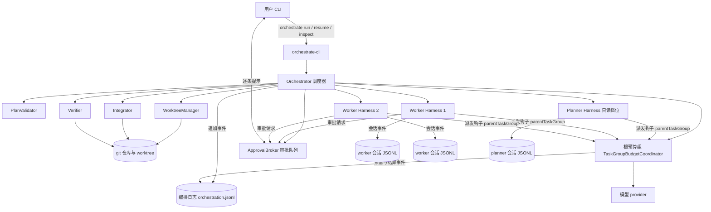
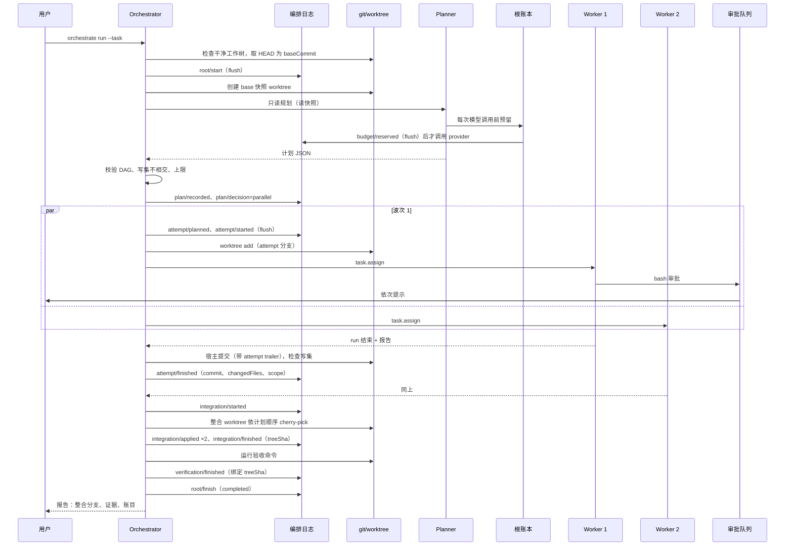
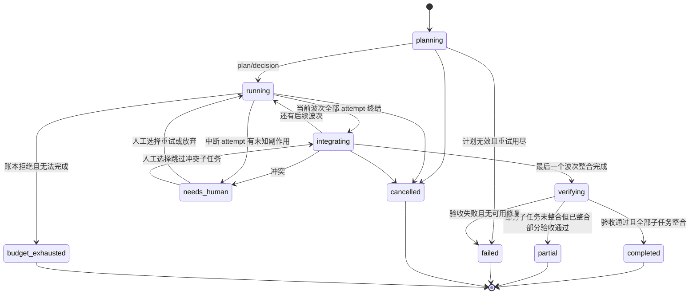
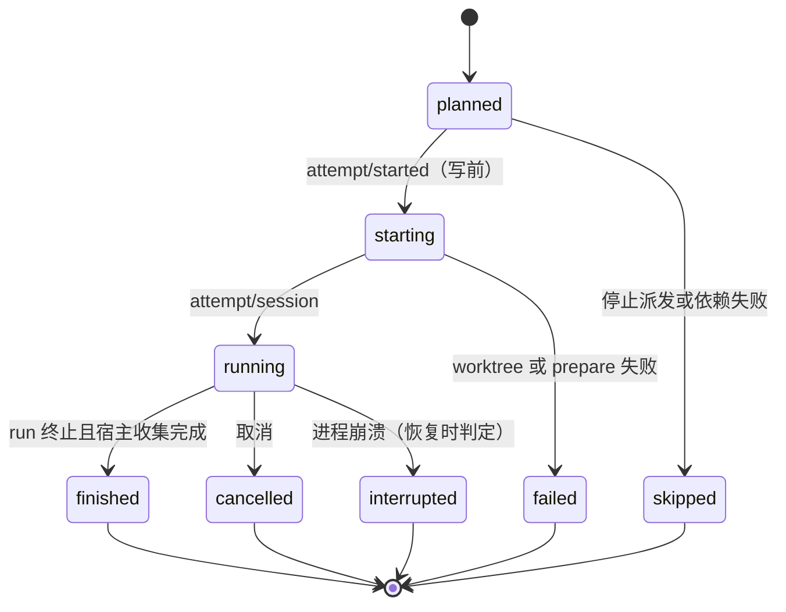

# mini-DSH 多 Agent 编排开发文档（Super Agent 方向）

- **状态：设计稿，尚未实现。** 本文所有"拟实现""延后"能力在 main 上都不存在；不得据此宣称功能完成。
- **日期：** 2026-11-06
- **基线：** `main` = `origin/main` = `91de4682dd6aabaec5911a6dbab9e91a0847d4e5`（PR #24 合并，v0.2.0），工作区 `D:\Agent\mini-DSH-execution`，调研时无未提交改动。
- **范围：** 代码调研、架构设计与开发计划。未修改业务代码，未执行付费模型评测，未提交或推送。
- **已确认的方向（2026-11-06）：** D8 审批策略；**先把分支的方案 A（只读委派与任务组预算）移植回 main 作为 M0**，再在其上实现方案 B。M0 对 B 的影响见 §2.9。
- **契约归属：** 本文是领域对象、消息协议、编排日志与里程碑的唯一维护处。开始编码后，范围与决策变化按 [AGENTS.md](../../AGENTS.md) 同步到需求/决策记录，逐步证据写入新专题的 `CHANGES`，不在多处重复维护同一契约。

## 0. 阅读约定

| 标签 | 含义 |
| --- | --- |
| **已存在** | 在基线 `91de468` 的 main 上可由源码与测试验证 |
| **分支已有** | 只在 `feat/memory-team-eval-v2@2f2dca9` 上存在，main 已撤回（`46b8fb1`） |
| **拟实现** | 本文计划在 MVP 或核心扩展中实现 |
| **延后** | 明确不进约 5 周计划（M0–M4），只保留设计位置 |

源码证据写成 `路径:行号`，均指基线 `91de468`，另有说明除外。官方原型证据指 `deepseek-ai/dsh-superagent-prototype@8c32a9d`（本地检出 `D:\Agent\tmp\superagent-src`，与 GitHub 远端最新提交一致）。

---

## 1. 项目基线与调研结论

### 1.1 工作目录核对

| 目录 | 分支 / 提交 | 结论 |
| --- | --- | --- |
| `D:\Agent\mini-DSH-execution` | `main@91de468` = `origin/main`，干净 | **唯一主仓**，本文基线 |
| `D:\Agent\mini-DSH` | `main@73f3439`（2026-10-15）+ 10 个未提交文件 | 有 `STALE-DO-NOT-EDIT.md`，落后主仓 177+ 提交，不在此设计或写入 |
| `D:\Agent\mini-DSH-memory-team` | `feat/memory-team-eval-v2@2f2dca9` | 只读参考分支，不合并 |
| `D:\Agent\BeforeLanding-mini-DSH`、`mini-DSH-nx42` 等 | 旧提交或实验分支 | 与本文无关 |
| `.zread/wiki` | 主仓中不存在 | 本次全部结论直接来自源码 |

已读文档：`AGENTS.md`、`README.md`、`PROGRESS.md`、`docs/ARCHITECTURE.md`、`test/fixtures/coding/README.md`；分支的 `docs/memory-team/{REQUIREMENTS,PLAN,TASKS,REVIEW-PR7,VALIDATION-20261026,EVALUATION}.md`。

### 1.2 main 现有能力（已存在）

| 能力 | 源码证据 | 对本设计的意义 |
| --- | --- | --- |
| 生产与评测共用的装配入口 | `src/app/create-harness.ts:47-80`：一次 `createHarness` 创建一个 Cordis `root`，装载会话、提示、工具、LLM、Agent、Loop、沙箱、文件与 Bash 工具 | 可在同一进程里多次调用，为每个 Agent 建独立 Harness；分支 `buildChild` 已这样做过 |
| 单 Agent 循环 | `src/core/agent-loop-runtime.ts:58-407`：投影、压缩、模型请求与重试、工具批次、终态 | 不重写。worker 就是一个完整的单 Agent |
| 事件溯源会话 | `src/core/session-runtime.ts:241`（`append` 分配 `seq` 并做 `validatePayload`）；`src/core/event-store.ts:80`（`writer.lock`）、`:97-110`（逐条 `fsync`） | 子会话直接复用；会话事件集合是封闭的（`src/core/event-validation.ts:34-72`，未知类型抛错），不往里塞编排事件 |
| 崩溃恢复不重跑未知工具 | `session-runtime.ts:37-78`：已开始未收尾的工具补 `unknown`，未开始的补 `skipped`；`:156` 起 `beginRun` 在存在 `unknown` 结果时拒绝续跑 | 编排恢复沿用同一原则，上升到 attempt 级 |
| 单 run 预算 | `src/core/budget.ts:40-48`（`CLI_BUDGET`：64 请求 / 128 工具 / 2M token / 600 s）；`src/core/run-budget-runtime.ts:38-45`（输出额度）、`:82-95`（审批暂停计时，`approvalTimeoutMs`） | 只约束一个 session 的一次 run；**没有跨会话的根任务账本** |
| 用量来源区分 | `budget.ts:84`：`Usage.source: 'provider' \| 'estimated'`、`uncertain`、`cacheReadTokens` | 账本按来源分列 |
| 拒绝派发的语义 | `src/core/model-dispatch.ts:1-6`（`ModelNotDispatchedError`）；`agent-loop-runtime.ts:239-245` 记 `model/rejected`，`request_limit` 转 `max_steps` | 根账本可在适配器层拒绝请求，Loop 已能正确收尾 |
| 供应商错误分类 | `src/core/model-error.ts:5`（`rate_limit` 等），`:28`（`retryable`、`retryAfterMs`） | 共享 429 冷却可在适配器层实现 |
| 集中授权 | `src/core/tool-runtime.ts:24-29`（全 root 唯一的 `setAuthorization`）；`src/core/tool-authorization.ts:22-23`（声明一致的内置工具直接放行，写入/Bash 的审批在工具内部调用 `sandbox.approve`） | 写入与 Bash 审批发生在工具内，经 root 唯一的 approver |
| 审批通道 | `src/core/sandbox-runtime.ts:204-216`：一个 root 一个 approver；`autoApprove` 时跳过；`src/plugins/sandbox.ts:27`：未显式传入时读取环境变量 `MINI_DSH_AUTO_APPROVE` | worker Harness 必须显式传 `autoApprove: false`，否则会继承环境变量 |
| CLI 审批 | `src/plugins/cli.ts:84`：readline 单问单答 | 多个 Agent 并发审批会争用同一输入，需要队列 |
| 版本化验证证据 | `src/tools/bash.ts:20-63`（`verification.files` 前后哈希）；`src/core/task-verification.ts` | worker 内部证据只覆盖其 worktree；整合后必须由宿主重新验证 |
| 任务改动与报告 | `src/core/task-changes.ts`、`src/core/task-trace.ts` | worker 结果中的"改了什么"由宿主从 git 取，不靠模型自述 |
| token 估算 | `src/core/token-estimator.ts:8-11`（`estimateInput`） | 用于预留额 |
| 离线脚本模型 | `src/app/demo.ts:28-39`、`test/harness.ts` | 所有编排测试使用脚本模型 |

### 1.3 现有作用域：Agent 注册表不等于多 Agent 隔离

`AgentRuntime.create`（`src/core/agent-runtime.ts:24-40`）只生成 `{id, sessionId, model, budget}` 并登记到 Map。同一个 `root` 里的多个 Agent 共享下表中的一切：

| 服务 | 作用域 | 同 root 多 Agent 的问题 |
| --- | --- | --- |
| `ToolRuntime` | 每 root 一张工具表；`schemas()` 返回全部工具（`tool-runtime.ts:62-71`），Loop 每轮取全部（`agent-loop-runtime.ts:104`） | 无法按角色限制工具 |
| `SandboxRuntime` | 每 root 一个 `workspace` 与 approver | 所有 Agent 写同一工作区，审批无法区分来源 |
| `SystemPromptRuntime` | 每 root 一组段落 | 无法给不同角色不同身份与约束 |
| `AgentLoopRuntime` | `setCompletionCheck`/`setWorkspaceProbe` 只能设置一次（`agent-loop-runtime.ts:33-41`），绑定 root 的工作区 | 收尾检查无法按 Agent 区分 |
| `SessionRuntime` | 可容纳多个 session，每个 session 独立日志 | 这一层本身可多会话，但预算只在单 run 内 |
| `LlmRuntime` | 每 root 一组 provider | 没有跨 root 的派发闸门 |

**结论：** 多 Agent 隔离的最小可靠单位是"一个 Agent 一个 Harness（一个 root）"，加上独立工作区、独立会话目录和独立 approver。分支的 `buildChild` 与官方原型的"一个 Ticket 一个 Executor Session 加一个目录"都采用这个粒度。

### 1.4 `feat/memory-team-eval-v2`：可复用、需改造、无关

分支基于 PR #7 合并提交 `0b8b973`，相对 PR #7 之前的 main（`a5d9191`）新增约 4.5k 行（含记忆）。功能均默认关闭，用户已于 2026-10-27 暂缓其后续开发与评测（`docs/memory-team/PLAN.md`）。

| 分支实现 | 位置（分支） | 判断 | 理由 |
| --- | --- | --- | --- |
| 只读角色工具白名单 `READ_ONLY_TOOLS`，`files` 插件 `allowedTools`，只读角色不装 Bash/MCP/结果存储 | `src/core/agent-capabilities.ts`、`create-harness.ts` diff | **可复用（思路与少量代码）** | 本方案的 planner 与后续 reviewer 需要同样的强制方式；只移植"工具档位"这一小块，不移植角色体系 |
| 子 Harness 构造 `buildChild`：独立 `JsonlStore`、显式 `contextWindowTokens`、`dispose` 关闭会话 | `create-harness.ts` diff | **可复用（模式）** | worker 构造与之同构，但工作区换成 worktree、approver 换成审批队列 |
| 任务组预算 `TaskGroupBudgetCoordinator`：预留 → 已派发 → 结算/释放/未知，root floor，串行队列，持久化后派发 | `src/core/task-group-budget.ts` | **需改造后复用** | 状态机与"崩溃后预留释放、已派发转未知"的规则直接借鉴；但它写在根会话日志里（扩展了会话事件类型）且依赖 `LlmRuntime.setDispatchGuard` 与 `ChatRequest.dispatchScope` 契约修改。本方案改为写入独立编排日志、在适配器包装层执行，不改会话契约 |
| `delegate_tasks` 工具：模型在一次工具调用中同步派发 1–4 个只读子任务，`maxConcurrent ≤ 2` | `src/plugins/delegation.ts`、`src/core/delegation-runtime.ts` | **不作为 MVP 主路径** | 由模型决定何时委派、子 Agent 只读、结果回到父会话一个工具结果。本方案改为宿主驱动的编排；该工具可作为延后的"只读分析"能力再议 |
| 有界结构化结果 `parseChildFindings`、批次截断 `boundDelegationBatch`、证据哈希复核 | `src/core/delegation-contracts.ts` | **可复用（约束）** | 结果字节/token 上限、证据必须带内容哈希、宿主复核哈希，这些约束保留；worker 的版本身份改用 git commit/tree SHA |
| 委派恢复：读已落盘制品，缺失则标 `interrupted`/`skipped`，绝不重跑子任务 | `src/core/delegation-recovery.ts` | **复用原则** | attempt 级恢复同样"不重跑已开始的执行" |
| reviewer 候选版本与 `stale` 检测 | `src/core/review-candidate.ts` | **延后复用** | 以 commit SHA 绑定后更简单，放到核心扩展 |
| 项目记忆（MemoryStore/Retriever/Runtime） | `src/core/memory-*.ts` | **无关** | 与本方案正交，不引入 |
| v2/v2.1 开发评测执行器与验收器 | `scripts/memory-team-*` | **借鉴协议** | 两阶段、统一账本、makespan 与总主动时间分开报告等口径值得沿用 |

**移植可行性（2026-11-06 核对）：** 自 `a5d9191` 以来，main 在分支同样改过的文件中只有 5 个有变化，共 +62/−6 行（`create-harness.ts`、`agent-loop-runtime.ts`、`contracts.ts`、`event-validation.ts`、`tool-results.ts`，来自 SWE 组件移植）。团队代码对记忆模块的依赖只有 `memoryHash`、`sha256`、`recordObject` 三个单行工具、`readBoundedMemoryFile` 一个函数，以及委派中可选的 `MemoryViewSnapshot`/`MemoryController` 参数。因此按文件移植并抽出中性工具模块即可，**不采用"撤销 `46b8fb1`"**，因为那会把记忆功能一并带回。

分支已有的开发观察（`docs/memory-team/EVALUATION.md`，仅设计输入）：v2.1 中 W03（并行调查）团队臂实际委派 2 批 / 4 个子会话，相对单 Agent 约 +74.5k token、+8 请求、+17 s，验收结果相同（1/1 对 1/1）。**本批没有观察到只读并行调查的收益，只观察到协作开销。** 这是本方案不以方案 A 作为 MVP 的直接依据之一。

### 1.5 官方参考：愿景、原型、本项目

| 主题 | 文章愿景（二手） | 原型已实现（`8c32a9d`，源码/文档核对） | 本项目拟实现 |
| --- | --- | --- | --- |
| 形态 | Router 接收消息、分派给并行 Worker；Watchdog、持久状态、执行环境 | 一个 GitHub 仓库的主动编程 Agent，作为 DSH bundle 运行；主 Session（orchestrator）+ 每 Ticket 一个 Executor Session（worker）（`README.md`、`docs/001-domain.md`） | 本地 CLI 内，一个根任务拆成若干子任务，由 worker 在独立 worktree 中并行执行，宿主整合并复验 |
| 并行单位 | Worker 并行 | **跨 Ticket 并行**：`WorkerSlots` 限制并发（`src/executor/dsh.ts:171-196`）；同一 Ticket 不拆成多个写入者 | **同一根任务内并行**：子任务按写集隔离，宿主整合 |
| 隔离 | 独立执行环境 | 每 Ticket 一个目录，prepare 命令通常用 `git worktree`；文档明确"这不是安全边界"（`docs/003-execution.md`） | 每 attempt 一个 worktree + 分支 + 会话目录；同样声明不是 OS 沙箱 |
| 持久化 | 持久状态 | 单个 SQLite（`docs/007-architecture.md` Persistence）；事务内入队、提交后执行的 `Effects` 队列（`src/app/effects.ts`），按 kind/key 去重、指数退避 | 独立编排 JSONL（写前日志）+ 现有会话 JSONL；不引入 SQLite |
| 事件与去重 | 外部事件持续驱动 | Trigger 按 ID 去重（`src/core/intake.ts:23`）；GitHub 游标回退 5 秒重叠轮询（`src/sources/github.ts:198-248`）；丢弃机器人自身消息 | 阶段 C 先本地模拟事件，再接 GitHub 轮询；同样的游标 + 去重 + 自触发过滤 |
| 授权 | 只在被请求或规则允许时行动 | 确定性 gate（allowlist、admission 表、bot list）+ 模型 assessment；`observe` 为默认 accept mode；Mandate 不可变（`docs/002-authorization.md`） | 阶段 C 采用 gate + observe/dry-run；MVP 的授权就是本地用户本人 |
| 写入整合 | — | 由 PR 与人工审查承担，宿主没有合并逻辑（`docs/003-execution.md` Merging） | **宿主做确定性整合 + 整合后复验**（本项目的主要增量） |
| 量化结果 | 二手报道称中位完成时间降低约 39%、缓存 token 约 3.8 倍；单会话被告知"可委派"时 5 次均未调用子 Agent | 原型仓库不含这组实验数据 | 不引用为证据；只作为"多 Agent 用更多计算换时间"的假设来源，由本项目自己的评测检验 |

DeepSeek Harness（`deepseek-ai/deepseek-harness@fcc0ad4`）：README 说明其为 Cordis "everything is a plugin" 架构；仓库内有 Agent Teams 实验包的架构记录（`.agents/notes/archived/architecture/2026-09-18-agent-teams-single-bundle.zh.md`）与 Agent 轮次生命周期文档（`docs/agent-lifecycle.zh.md`）。只核对了这三处，未阅读其 Teams 实现源码，本文不依赖其细节。

### 1.6 无法访问或未核实的来源

- 文章《Exploring Super-agent Design: Towards a More Autonomous Agent System》原文：WebFetch 失败，未读到原文。§1.5 的"文章愿景"一列只来自二手报道（[Analytics India Magazine](https://analyticsindiamag.com/ai-news/deepseek-proposes-super-agent-architecture-to-automate-ai-coding-workflows)、[Dataconomy](https://dataconomy.com/2026/11/02/deepseek-releases-open-source-dsh-superagent-coding-agent/)、[Kingy AI](https://kingy.ai/blog/deepseek-super-agent-design-explained/)），数字不作为证据使用。
- DeepSeek Harness 的 subagent/Teams 源码：未读。
- 官方原型只抽查了 `intake.ts`、`admission.ts`、`effects.ts`、`executor/dsh.ts`、`sources/github*.ts` 的相关片段，以及 000–003、007 号文档；其余模块未逐行审阅。

### 1.7 调研结论

1. main 的单 Agent 内核（Loop、事件日志、run 预算、恢复语义）可靠，不需要也不应该为多 Agent 重写。
2. 同一 root 内的多 Agent 没有隔离；隔离单位应是"一个 Agent 一个 Harness + 独立 worktree + 独立会话目录 + 统一审批队列"。
3. 方案 A（只读并行）已在分支实现且通过审查，但开发观察里没有收益；再做一遍的独立增量很小。
4. 官方原型的并行发生在 Ticket 之间，写入整合交给 PR 与人。**同一根任务内的并行写入 + 宿主确定性整合 + 整合后复验**，既不在 main、不在分支，也不在原型里，是本项目最有工程深度、又能讲清楚的增量。
5. 根任务级账本是必须新建的部分；现有 run 预算只能作为每个 worker 的内层上限。

---

## 2. 推荐方案

### 2.1 三个概念的区别

| | 普通子 Agent 委派 | 多 Agent 协作 | 持续运行的 Super Agent |
| --- | --- | --- | --- |
| 触发 | 主 Agent 在一次 run 中调用工具 | 宿主或协调者为一个任务规划多个执行者 | 外部事件持续到达，系统自己决定是否开工 |
| 生命周期 | 嵌在父 run 的一次工具调用里，父等待结果 | 一个根任务，从规划到整合 | 长期进程，跨多个任务，有游标与订阅 |
| 写入 | 通常只读，或写同一工作区 | 需要解决多写入者的隔离与整合 | 每个任务各自写入，通常各自出 PR |
| 关键难题 | 结果有界、不越权、不重复花钱 | 拆分质量、写集冲突、整合后语义冲突、统一预算 | 授权、去重、自触发、人工注意力、恢复 |
| 在本项目 | 分支已有（只读） | **MVP + 核心扩展** | **长期扩展（阶段 C）** |

### 2.2 先完成哪种闭环

**先完成"单根任务、宿主驱动的多写入者闭环"：** 规划 → 校验 → worktree 中并行执行 → 宿主提交与写集检查 → 确定性整合 → 整合后复验 → 报告。

理由：

- 它是 A 与 C 的共同前提。C 的每个事件最终要落成一个根任务；A 的只读角色是它的一个工具档位。
- 它能在本地、离线、无外部账号的条件下完整测试（脚本模型 + 真 git + 故障注入）。
- 它与 main 的单 Agent 基线可以在同一任务、同一预算下直接对照。
- 它的失败模式（写集越界、文本冲突、各自通过但合起来失败、预算竞态、崩溃窗口）正是面试会追问的工程问题。

### 2.3 哪些任务值得委派

宿主只在下列结构条件**全部**满足时进入并行路径；否则走单 worker 路径（同样在 worktree 中执行，仍受账本与恢复保护）：

1. 计划中至少两个子任务在同一波次且彼此无依赖；
2. 各子任务声明的写集两两不相交（按规范化的相对路径与目录前缀判断）；
3. 每个并行子任务有自己的验收命令或可由宿主检查的产物；
4. 子任务数不超过 `maxSubtasks`，并发不超过 `maxWorkers`；
5. 用户没有指定 `--mode single`。

适合并行：多个相互独立的模块各自实现与测试；同一接口的多个独立实现；文档、测试、实现分属不同文件且接口已固定的工作。

继续由单 Agent 完成：单一根因的缺陷定位；跨模块重命名或共享接口重构；一行到几行的小改动；必须先做一次设计决定的任务；验证成本高于实现成本的任务；后一步依赖前一步产物的流水线。

模型只给出拆分建议；是否并行由宿主按以上规则判定并写入日志（`plan/decision`），模型不能绕过。

### 2.4 方案比较

| 维度 | A：主 Agent 唯一写入，子 Agent 只读并行 | B：多执行者独立 worktree 写入，协调者整合 | C：事件驱动协调者持续管理多任务 |
| --- | --- | --- | --- |
| 现状 | 分支已有，main 无 | 都没有 | 官方原型已有完整形态 |
| 主要价值 | 减少主上下文中的调查内容 | 并行实现、写入隔离、可验证整合 | 降低人工注意力、持续响应 |
| 已有收益证据 | 分支 W03：无收益，+74.5k token | 无（需本项目评测） | 原型未附数据；二手报道有 |
| 独立工程增量 | 小（移植） | **大**：worktree 生命周期、写集、整合、复验、根账本、attempt 恢复 | 中：多为复刻原型 |
| 个人 4–5 周可完成 | 是（移植约 1 周） | 是（裁剪后） | 只能做雏形 |
| 外部依赖 | 无 | git | GitHub 账号、机器人身份、轮询 |
| 风险 | 低 | 中：拆分质量与冲突 | 高：授权与噪声 |

**选择：** 先以 M0 把分支的 A 移植回 main（默认关闭），**MVP 的新增能力仍是 B 的最小形态**，并复用 A 的角色白名单与任务组预算；C 只预留接口与本地模拟事件。A 的移植是已有独立扩展回归 main，不计为本次新增贡献（§15.4）。

### 2.5 范围边界

| 能力 | M0 + MVP（约 5 周） | 多 Agent 核心扩展 | 长期自治扩展 |
| --- | --- | --- | --- |
| 只读委派（方案 A） | M0：`delegate_tasks`、只读角色、任务组预算、不重跑恢复，移植回 main，默认关闭 | reviewer 以 commit SHA 绑定 | — |
| 拆分 | 计划文件（人工）+ 只读 planner（模型） | 运行中重规划（波次之间） | 事件触发的自动规划 |
| 执行 | ≤ 2 个并发 worker（上限 4），深度 1 | 只读 reviewer/test designer 角色 | 跨根任务的并发槽 |
| 整合 | 宿主按计划顺序 cherry-pick；冲突即停 | 冲突后串行重跑；整合修复 attempt（≤ 1） | 自动开 PR |
| 验证 | 宿主在整合 worktree 运行验收命令，证据绑定 tree SHA | reviewer 结论绑定 commit SHA | CI 结果作为事件 |
| 预算 | 根账本：请求、token、wall；预留/结算/未知 | 价格表与金额上限 | 跨任务日预算 |
| 恢复 | 写前日志、attempt 级不重跑、整合可重建 | 子进程隔离（可选） | 守护进程重启恢复 |
| 人工 | 审批队列；冲突/未知副作用决策 | 运行中追问 | 订阅与追问路由 |
| 事件 | — | 本地模拟事件源 | GitHub 轮询、observe/dry-run |

### 2.6 非目标

- 不重写单 Agent 内核，不修改会话事件契约（`EventData`）。
- 不引入 LangGraph、AutoGen、Redis、Kafka、数据库或向量记忆。编排状态量小、单写入者、需要逐条审计，JSONL 足够。
- 不做 OS 级沙箱；worktree 只是文件工作区隔离，Bash 仍可访问当前用户可访问的文件。
- 不让模型做文本冲突合并，不让模型修改编排状态。
- 不自动改动用户的工作树、不推送分支、不自动合并、不修改用户的 Git 身份。
- 第一版不接入飞书、多仓库、定时调度、管理后台。
- 不把离线模拟通过率当作模型能力证据；不预设多 Agent 提升成功率。

### 2.7 本次独立工程增量

| 相对 | 增量 |
| --- | --- |
| main | 根任务编排：计划校验、波次调度、并发写入隔离、宿主整合与复验、根账本、编排日志与 attempt 级恢复、审批队列、`orchestrate` CLI |
| 分支（M0 后即 main） | 在"模型调用工具同步委派只读子任务"之外，新增"宿主驱动的多写入者编排"；任务组预算从"只能挂在根会话上"扩展为可挂在编排日志上的同一状态机；版本身份在 worktree 场景下改用 git SHA |
| 官方原型 | 原型在 Ticket 之间并行、整合交给人；本项目在一个根任务内并行并由宿主整合、复验；持久化用 JSONL 写前日志而非 SQLite 事务 |

### 2.8 关键决策

| # | 决策 | 备选 | 选择理由 | 代价 |
| --- | --- | --- | --- | --- |
| D1 | MVP 选 B 的最小形态 | A；C | §2.4：增量最大、可离线完整测试、能和单 Agent 公平对照 | 拆分质量依赖模型；并行写入天然有冲突面 |
| D2 | 宿主驱动编排：模型只提计划，状态迁移由代码执行 | 分支式 `delegate_tasks`（模型决定何时委派） | 并行与否、预算、整合都需要确定性；官方报道也显示单会话很少主动委派 | 编排入口与单 Agent CLI 分开；模型无法临时追加子任务 |
| D3 | 单进程异步，每个 Agent 一个 Harness | 子进程；独立服务 | `createHarness` 已支持多实例；进程内取消、计时、测试最简单 | worker 崩溃会带倒编排进程（由写前日志与恢复兜底）；子进程留作扩展 |
| D4 | 独立编排 JSONL，会话日志不变 | 扩展会话事件（分支做法）；SQLite（原型做法） | 不动已验收的会话契约与 inspect；单写入者 + 小数据量用 JSONL 足够，沿用项目已有的写前日志纪律 | 编排日志与会话日志之间没有原子事务，需要显式崩溃窗口处理（§8.4） |
| D5（M0 后修订） | 根账本复用 M0 移植的 `TaskGroupBudgetCoordinator` 状态机与 `LlmRuntime` 派发钩子；持久化抽象为 `GroupJournal`，A 写根会话日志、B 写编排日志 | 适配器包装层另建账本（本文初稿）；B 自建一套账本 | 一套预留/派发/结算/未知规则、一组测试；请求按 Loop 的 `requestId`（`dispatchScope`）对账，消除初稿中"账本 ID 与会话请求只能按顺序关联"的代价；工具准入与组 wall deadline 也随之复用 | 需要把协调器的持久化从会话日志中抽离（M1 的第一个提交）；分支"取消导致的未知用量即中止整组"的规则对 B 过严，需按 §7.4 区分崩溃与取消 |
| D6 | git worktree + 宿主提交 + cherry-pick 整合 | 共享工作区加文件锁；补丁文件 | git 提供基线、差异、冲突检测和可回退的分支；整合结果是普通分支，用户自行合并 | 需要 git 仓库；每个 worktree 需要准备依赖（prepare 命令） |
| D7 | 写集事后强制：宿主用 `git diff` 检查越界，越界即拒绝整合 | 工具级路径限制 | 能同时覆盖文件工具与 Bash 的写入；无需修改审批契约 | 越界要到 attempt 结束才发现，浪费该 attempt 的预算；提示词与审批摘要做事前提醒 |
| D8（用户已确认，2026-11-06） | worktree 内文件工具写入默认自动批准，Bash 默认需人工批准，审批走 FIFO 队列 | 全部人工；全部自动 | worktree 内写入不触及用户工作树、可整体丢弃、事后有写集检查；Bash 可越出 worktree，仍需人工 | 这是新模式下的审批策略变化，必须写入需求与决策记录；`--approve-writes ask` 可恢复逐条审批 |
| D9 | 文本冲突即停，交给人选：串行重跑 / 放弃子任务 / 中止 | 让模型合并 | 确定、可审计；写集不相交时冲突本应罕见 | 少数任务需要人工介入一次 |
| D10 | 根任务验收 = 宿主在整合 worktree 运行验收命令，证据绑定 tree SHA | 信任各 worker 的验证 | 各自通过不代表合起来通过 | 增加一次验证耗时 |
| D11 | 重试 = 新 attempt、新 worktree，从基线开始 | 在原 worktree 继续 | 文件副作用被旧 worktree 隔离，重试不重复编辑 | 丢弃旧 attempt 的进度 |
| D12 | planner 只读，读取基线快照 worktree | 读取用户工作树 | 计划与 worker 看到同一版本；只读由工具档位强制 | 用户未提交的改动对 planner 不可见（默认拒绝脏工作树，见 §5.4） |
| D13（2026-11-06 确认） | 先移植方案 A 回 main（M0），再做 B | 直接在 main 上做 B，A 留在分支 | B 需要的角色白名单、任务组预算、派发钩子、不重跑恢复都已在 A 中实现并通过审查；先移植可复用而不是重写；评测中的"简单委派"臂可以直接使用真实的 A | 总工期约多 1 周；main 的交付范围与 README/PROGRESS 的"已知边界"必须同步修改 |

### 2.9 M0（移植方案 A）对 B 的影响

| B 的部件 | 初稿设计 | M0 之后 |
| --- | --- | --- |
| planner 只读档位 | 新增 `toolProfile: 'read-only'` | 使用 A 的 `READ_ONLY_TOOLS` 与 `files` 插件 `allowedTools`；新增角色 `planner`（与 `analyst` 同档位、不同身份提示） |
| worker 档位 | 新增 `toolProfile: 'worker'` | 等价于 A 的 `coordinator` 角色，且不传 `mcpServers`、不开 `delegation`；不新增配置字段 |
| 根账本 | 适配器包装层的新账本 | `TaskGroupBudgetCoordinator` + `OrchestrationGroupJournal`；worker Harness 通过 A 已有的 `parentTaskGroup` 加入根预算组 |
| 共享 429 冷却、在途上限 | 账本内实现 | 作为协调器 `dispatch` 的附加准入条件实现 |
| 子 Agent 结果有界与哈希复核 | 参照分支 | 直接复用 `delegation-contracts.ts` 的上限常量与校验风格 |
| 评测"简单委派"臂 | 关闭治理的同一编排器 | 真实的方案 A：单 Agent + `delegate_tasks` |
| 深度 1 | worker 不注册编排工具 | 同上，另外 worker 的 `delegation.mode` 固定为 `off` |

---

## 3. 架构

### 3.1 整体架构



`Planner Harness` 与每个 `Worker Harness` 都是一次独立的 `createHarness` 调用，内核与 main 的单 Agent 完全相同；差异只在传入的 `workspace`（worktree 路径）、工具档位、`adapter`（账本包装）、approver（审批队列）和预算。

### 3.2 正常执行时序



### 3.3 进程与隔离模型

- 一个编排进程对应一个根任务的写入者（编排日志的 `writer.lock` 保证）。
- 进程内：一个 planner Harness、最多 `maxWorkers` 个 worker Harness 同时存在；每个 Harness 自己的 Cordis `root`，`dispose` 时释放。
- 模型调用的全部并发通过同一个根预算组（`TaskGroupBudgetCoordinator`）串行准入。
- 子进程隔离延后：只有当 worker 内出现阻塞事件循环或内存泄漏的实测问题时才引入。

### 3.4 职责划分

| 职责 | 宿主代码（确定性） | 模型 | 人 |
| --- | --- | --- | --- |
| 拆分 | 校验计划结构、写集、上限；决定单/并行 | 提出子任务、写集、验收命令 | 可提供计划文件或强制单路径 |
| 执行 | 创建 worktree、分配预算、派发、取消 | 在 worktree 内实现与自测 | 批准 Bash |
| 状态 | 全部状态迁移、日志写入 | 无 | 无 |
| 整合 | 提交、写集检查、cherry-pick、冲突检测 | 无（MVP） | 冲突时选择处置 |
| 验收 | 运行验收命令、绑定 tree SHA | 报告不确定项 | 最终合并整合分支 |
| 预算 | 预留、结算、未知用量、拒绝派发 | 无 | 确认崩溃后的未知用量 |
| 恢复 | 对账、标记中断、禁止自动重跑 | 无 | 决定是否重试中断 attempt |

---

## 4. 领域模型与契约

### 4.1 对象与 ID

| 对象 | ID 形式 | 生成者 | 关系 |
| --- | --- | --- | --- |
| RootTask 根任务 | `rt_<uuid>` | 宿主 | 一个用户请求或一个被接受的事件；拥有一个编排日志、一个账本、一个 `baseCommit` |
| Plan 计划 | `pl_<uuid>`，`planVersion` 递增 | 宿主（内容来自文件或 planner） | 属于根任务；MVP 只有 v1，重规划产生新版本 |
| Subtask 子任务 | `st-<n>`（计划内稳定） | 计划 | 属于计划；可依赖其他子任务；有写集 |
| Attempt 执行尝试 | `at_<uuid>` | 宿主 | 一个子任务的一次执行：一个 worker Harness、一个 worktree、一个会话目录；`epoch` = 该子任务第几次尝试 |
| Message 消息 | `msg_<uuid>` | 发送方所在宿主组件 | 属于根任务，可关联 attempt；带 `idempotencyKey` |
| Artifact 产物 | `sha256:<hex>` | 宿主 | 内容寻址的有界 JSON（结果、验证摘要、日志尾部）；代码产物用 commit SHA |
| Integration 整合 | `ig_<uuid>` | 宿主 | 一个波次（或最终）的整合，产出整合分支 head 与 tree SHA |
| Reservation 预留 | `rv_<uuid>` | 账本 | 一次 provider 调用的准入记录 |
| HumanRequest 人工介入 | `hr_<uuid>` | 宿主 | 冲突、未知副作用、预算追加、worker 追问 |
| 会话 | 现有 `sessionId` | `SessionRuntime` | 每个 attempt / planner 恰好一个会话；meta 中写 `rootId`、`attemptId`（`session/start.meta` 是自由对象，不改契约） |

### 4.2 状态机

根任务：



Attempt：



`finished` 携带结果分类：`succeeded`（run `completed`、有改动、写集合规）、`no_changes`、`scope_violation`、`budget_stopped`、`run_failed`、`needs_input`。只有 `succeeded` 可进入整合。

### 4.3 不变量

| # | 不变量 | 由谁保证 |
| --- | --- | --- |
| I1 | 编排日志只由宿主写；模型输出只作为事件的数据字段，且有界 | `OrchestrationStore` 是唯一写入口 |
| I2 | 每个根任务同一时刻只有一个写入进程 | `writer.lock`（与 `JsonlStore` 同语义） |
| I3 | 任何 Agent 的每次 provider 调用都先有已落盘的 `budget/reserved` | 适配器包装；预留 flush 后才调用内层 adapter |
| I4 | 准入时 `已结算 + 未知计入 + 未结清预留 + 新预留 ≤ maxTotalTokens`，请求数同理 | 根预算组的 `reserve` 串行执行 |
| I5 | worker 没有任何编排或委派工具，深度恒为 1 | worker Harness 装配不包含此类工具 |
| I6 | 每个 attempt 独占一个 worktree、一个分支、一个会话目录；宿主不写用户工作树 | `WorktreeManager` 路径与分支命名 |
| I7 | 只有 `succeeded` 且写集检查通过的 attempt 进入整合，整合顺序为计划拓扑序 + 子任务序号 | `Integrator` |
| I8 | 验收证据绑定整合 tree SHA；tree 变化后旧证据为 `stale`，不得复用 | `Verifier` 与状态折叠 |
| I9 | 已进入 `starting` 的 attempt 永不自动重跑；重试是新 attempt、新 worktree | `Orchestrator` 与恢复 |
| I10 | 迟到消息（attempt 已终结或 epoch 过期）只记录为 `late`，不改变任何状态 | 状态折叠 |
| I11 | worker 结果正文 ≤ 8 KiB，摘要 ≤ 2 KiB；超限截断并标记 | `parseWorkerReport` |
| I12 | worker 输出、项目文档、外部评论都不能改变工具档位、写集、预算或授权 | 这些值只来自配置与已校验的计划 |

### 4.4 计划契约

```ts
// src/orchestration/contracts.ts（拟新增）
export interface PlanInput {
  version: 1
  rationale: string                 // ≤ 2 KiB，说明为何拆分或不拆
  sharedNotes?: string              // ≤ 4 KiB，接口约定等跨子任务说明
  subtasks: SubtaskSpec[]           // 1..maxSubtasks
}
export interface SubtaskSpec {
  id: string                        // st-1 …，计划内唯一
  title: string                     // ≤ 120 字符
  objective: string                 // ≤ 4 KiB
  writeSet: string[]                // 规范化相对路径或以 / 结尾的目录前缀，非空
  readHints?: string[]              // 建议先读的路径，不授予任何权限
  dependsOn?: string[]              // 子任务 id，必须构成 DAG
  acceptance: { commands: string[] } // 在该 worktree 内可运行的检查，≥1 条
}
```

宿主校验（`plan.ts`，拟新增）：

1. JSON 结构、字段长度、`subtasks.length ≤ maxSubtasks`；
2. 路径：相对、无 `..`、无反斜杠、无盘符、位于仓库内，且不命中受保护前缀（`.git/`、配置的 `protectedPaths`）；
3. 依赖构成 DAG，按拓扑分层得到波次；
4. **同一波次内写集两两不相交**（文件与目录前缀互不包含）；跨波次可重叠（后一波次基于前一波次的整合结果）；
5. 验收命令通过现有 `SandboxRuntime.inspectCommand` 形状检查；
6. 决定 `mode`：存在 ≥ 2 个同波次子任务且用户未强制单路径则 `parallel`，否则 `single`（多个子任务合并为一个 worker 顺序执行，写集取并集）。

计划示例：

```json
{
  "version": 1,
  "rationale": "三个解析器位于不同文件，接口已在 src/types.mjs 固定，可独立实现与测试。",
  "sharedNotes": "不要修改 src/types.mjs；每个解析器导出 parse(text) 返回 {ok, value|error}。",
  "subtasks": [
    { "id": "st-1", "title": "CSV 解析", "objective": "实现 src/csv.mjs …", "writeSet": ["src/csv.mjs", "test/csv.test.mjs"], "acceptance": { "commands": ["node --test test/csv.test.mjs"] } },
    { "id": "st-2", "title": "查询串解析", "objective": "实现 src/query.mjs …", "writeSet": ["src/query.mjs", "test/query.test.mjs"], "acceptance": { "commands": ["node --test test/query.test.mjs"] } },
    { "id": "st-3", "title": "汇总入口", "objective": "在 src/index.mjs 导出两个解析器", "writeSet": ["src/index.mjs"], "dependsOn": ["st-1", "st-2"], "acceptance": { "commands": ["node --test"] } }
  ]
}
```

### 4.5 消息协议

MVP 中所有参与者都在同一进程，消息是宿主组件之间的结构化记录；它们与编排日志事件一一对应，以便恢复和审计。阶段 C 的外部输入使用同一信封。

```ts
export type MessageType =
  | 'task.assign' | 'task.result' | 'task.failure' | 'task.question'
  | 'task.cancel' | 'human.request' | 'human.response' | 'input.followup'

export interface MessageEnvelope<T extends MessageType = MessageType, B = unknown> {
  protocol: 'mini-dsh.orch/1'
  messageId: string                // msg_<uuid>
  idempotencyKey: string           // 见 §6.1，同键只生效一次
  rootId: string
  attemptId?: string
  epoch?: number                   // 发送时 attempt 的 epoch
  causationId?: string             // 触发本消息的 messageId
  from: 'host' | 'planner' | 'worker' | 'human' | 'source'
  type: T
  createdAt: string
  body: B
}

export interface TaskAssign {
  subtaskId: string; planVersion: number; baseCommit: string
  objective: string; writeSet: string[]; readHints: string[]
  acceptance: { commands: string[] }
  dependencies: { subtaskId: string; commit: string; changedFiles: string[]; summary: string }[]
  sharedNotes?: string
  limits: { maxReportBytes: number; budget: { maxModelRequests: number; maxToolCalls: number; maxTotalTokens: number } }
}

export interface TaskResult {
  // 宿主事实：从 git、会话日志与账本收集，模型无法伪造
  run: { sessionId: string; status: string; stopReason?: string }
  code: { baseCommit: string; commit?: string; tree?: string; changedFiles: string[]; scopeViolations: string[] }
  verification: { command: string; exitCode: number | null; tree: string; evidence: string }[]
  usage: { requests: number; providerTokens: number; estimatedTokens: number; unknownChargedTokens: number; cacheReadTokens: number }
  // 模型报告：有界，作为不可信输入
  report: { status: 'done' | 'needs_input' | 'blocked'; summary: string; uncertainties: string[]; sources: { path: string; blob?: string }[]; valid: boolean; truncated: boolean }
  resultRef: string                // sha256:… 完整结果制品
}

export interface TaskFailure {
  stage: 'prepare' | 'worktree' | 'run' | 'collect' | 'commit'
  reason: 'budget' | 'provider' | 'tool_unknown' | 'scope_violation' | 'no_changes' | 'prepare_failed' | 'cancelled' | 'interrupted' | 'internal'
  retryable: boolean
  unknownSideEffects: boolean      // 存在 status=unknown 的工具结果，或中断时有已开始的 Bash
  detail: string                   // ≤ 1 KiB，安全文本
}

export interface TaskQuestion { question: string; options?: string[] }   // worker 以 needs_input 结束时生成
export interface TaskCancel { scope: 'dispatch' | 'running'; reason: string }
export interface HumanRequest {
  requestId: string
  kind: 'approval' | 'conflict' | 'unknown_side_effects' | 'budget_extension' | 'question'
  prompt: string; options: string[]; attemptId?: string
}
export interface HumanResponse { requestId: string; choice: string; note?: string; actor: 'local-user' }
```

worker 的最后一条助手消息须包含一个 JSON 报告块（由 worker 身份提示约定）：

```json
{ "status": "done", "summary": "实现了 parse，覆盖空输入、引号转义与 CRLF；新增 6 个测试。", "uncertainties": ["未处理 BOM，规格未提及"], "sources": [{ "path": "docs/SPEC.md" }] }
```

宿主组装后的 `task.result` 示例：

```json
{
  "protocol": "mini-dsh.orch/1",
  "messageId": "msg_6f1c…",
  "idempotencyKey": "result:at_91aa…:1",
  "rootId": "rt_3b0e…",
  "attemptId": "at_91aa…",
  "epoch": 1,
  "from": "host",
  "type": "task.result",
  "createdAt": "2026-11-20T10:31:02.114Z",
  "body": {
    "run": { "sessionId": "8d2c…", "status": "completed" },
    "code": { "baseCommit": "91de468…", "commit": "a1b2c3…", "tree": "f00d…", "changedFiles": ["src/csv.mjs", "test/csv.test.mjs"], "scopeViolations": [] },
    "verification": [{ "command": "node --test test/csv.test.mjs", "exitCode": 0, "tree": "f00d…", "evidence": "sha256:77e1…" }],
    "usage": { "requests": 9, "providerTokens": 84120, "estimatedTokens": 0, "unknownChargedTokens": 0, "cacheReadTokens": 51200 },
    "report": { "status": "done", "summary": "实现了 parse …", "uncertainties": ["未处理 BOM，规格未提及"], "sources": [{ "path": "docs/SPEC.md" }], "valid": true, "truncated": false },
    "resultRef": "sha256:3c9a…"
  }
}
```

`task.failure` 示例：

```json
{ "type": "task.failure", "attemptId": "at_5e07…", "epoch": 1, "idempotencyKey": "failure:at_5e07…:1",
  "body": { "stage": "run", "reason": "tool_unknown", "retryable": false, "unknownSideEffects": true, "detail": "进程中断时 bash 已开始：pnpm test" } }
```

`human.request` 示例（冲突）：

```json
{ "type": "human.request", "idempotencyKey": "human:conflict:ig_77…:st-2",
  "body": { "requestId": "hr_1d…", "kind": "conflict", "attemptId": "at_c4…",
    "prompt": "st-2 与已整合的 st-1 在 src/index.mjs 冲突。", "options": ["rerun-serially", "skip-subtask", "abort"] } }
```

### 4.6 编排日志事件协议

信封（每行一个 JSON）：

```ts
export interface OrchestrationEvent<K extends keyof OrchEventData = keyof OrchEventData> {
  v: 1; rootId: string; seq: number; id: string; at: string
  type: K; data: OrchEventData[K]
}
```

| 事件 | 关键字段 | 何时写（写前/写后） |
| --- | --- | --- |
| `root/start` | goal、repo 根、`baseCommit`、配置摘要、根预算 | 任何副作用之前 |
| `plan/recorded` | planId、planVersion、来源 file/model、plannerSessionId、计划、校验结果 | 规划结束后 |
| `plan/decision` | mode single/parallel、理由、波次 | 校验后、派发前 |
| `attempt/planned` | attemptId、subtaskId、epoch、wave、baseCommit、分配预算 | 派发前 |
| `attempt/started` | worktree 路径、分支名、会话目录 | **创建 worktree 之前**（写前） |
| `attempt/session` | sessionId | 会话创建并 attach store 之后 |
| `attempt/finished` | 分类、run 状态、commit、tree、changedFiles、scopeViolations、resultRef | 宿主提交与收集之后 |
| `attempt/late` | 迟到结果摘要 | 结果到达但 attempt 已终结 |
| `budget/reserved` | reservationId、attemptId 或 planner、purpose、reserve | **调用 provider 之前**（写前） |
| `budget/settled` | reservationId、usage（含 source、cacheRead）、overrun | provider 返回后 |
| `budget/released` | reservationId | 未派发即取消 |
| `budget/unknown` | reservationId、chargedTokens、cause crash/cancel/no_usage | 无可信 usage 时 |
| `approval/requested`、`approval/resolved` | requestId、attemptId、tool、摘要哈希、决定、来源 auto/user/timeout | 审计用，非恢复必需 |
| `integration/started` | integrationId、wave、基线 commit | cherry-pick 之前 |
| `integration/applied` | attemptId、源 commit、新 commit | 每次成功应用后 |
| `integration/conflict` | attemptId、冲突文件 | 冲突中止后 |
| `integration/finished` | head、tree | 波次整合完成后 |
| `verification/finished` | head、tree、命令、退出码、日志制品 | 验收命令结束后 |
| `human/requested`、`human/resolved` | HumanRequest / HumanResponse | 等待人工前 / 收到决定后 |
| `control/stop` | scope accepting/dispatch/running、原因 | 收到停止信号后 |
| `root/finish` | 终态、报告制品 | 最后 |

预算事件说明：M0 之后，表中的 `budget/*` 由根预算组以 M0 协调器的 `group/*` 事件类型（`group/budget-reserved`、`group/model-dispatched`、`group/budget-settled`、`group/reservation-released`、`group/usage-unknown`、`group/tool-admitted`）写入编排日志，两套命名只保留一套；上表保留语义说明。

校验：每种事件有独立的运行时校验（与 `event-validation.ts` 同风格，未知类型拒绝）；`seq` 严格递增；`id` 唯一；`v` 大于支持版本时只读打开，拒绝 `resume`。

### 4.7 结果的有界性与来源

- 父侧（编排器、后续 attempt、最终报告）只接收 `TaskResult`，不接收 worker 的会话历史。
- `code`、`verification`、`usage` 全部由宿主从 git、会话日志、账本取得；模型报告只提供摘要、不确定项和来源路径。
- 报告中的来源路径由宿主按整合 tree 解析出 blob SHA；不存在的路径标记 `unresolved`，不会被当作证据。
- 完整 worker 历史通过 `orchestrate inspect` 以"会话路径 + seq 区间"引用，不复制进编排日志。

---

## 5. 隔离与工具权限

### 5.1 每个 Agent 一个 Harness

worker 装配（拟新增 `src/orchestration/worker.ts`）：

```ts
const harness = await createHarness({
  workspace: attempt.worktreePath,
  profile: 'coding',
  adapter: baseAdapter,               // 同一 provider；预算由下面的根预算组在派发钩子处准入
  parentTaskGroup: rootGroup,         // M0 移植的配置项；rootGroup 的日志写入编排日志
  agentRole: 'coordinator',           // M0 移植：可写角色；不传 mcpServers、不开 delegation
  delegation: { mode: 'off' },
  autoApprove: false,                 // 显式关闭，避免继承 MINI_DSH_AUTO_APPROVE
  contextLayout: 'frozen', runtimeClockMode: 'frozen',
  hostGuidance: workerGuidance(assign), // 写集、报告格式、禁止事项
  ...(config.commandRunner ? { commandRunner: config.commandRunner } : {}),
})
harness.root.sandbox.setApprover(request => broker.request(attemptId, request))
const session = harness.root.sessions.create({ source: 'orchestrator', workspace: attempt.worktreePath, rootId, attemptId })
const store = await JsonlStore.open(attempt.sessionDirectory, session.id)
harness.root.sessions.attachStore(session.id, store)
const agent = harness.root.agents.create({ name: `worker-${subtaskId}`, sessionId: session.id, model, loop: harness.root.agentLoop, budget })
```

### 5.2 工具能力集

| 角色 | 文件读 | 文件写 | Bash | MCP | 编排/委派 | 强制方式 |
| --- | --- | --- | --- | --- | --- | --- |
| planner | 是 | 否 | 否 | 否 | 否 | M0 移植的只读角色（新增 `planner` 身份）：`READ_ONLY_TOOLS` 白名单同时限制 schema 与执行，不注册写工具与 Bash 插件；`capabilityManifest` 记录角色、工具清单与 schema 哈希 |
| worker | 是 | 是（worktree 内） | 是（需审批） | 否 | 否 | `coordinator` 角色，不传 MCP 配置，`delegation.mode = 'off'`；不存在任何编排或委派工具 |
| reviewer（核心扩展） | 是 | 否 | 否 | 否 | 否 | 同 planner |

权限由"工具是否注册"强制：未注册的工具在 `ToolRuntime.execute` 返回 `Unknown tool`，schema 也不会出现在请求中。提示词只是辅助说明。

### 5.3 Bash、MCP 与间接写入

- **只读角色不允许 Bash。** Bash 可以写文件、启动进程、联网，形状检查（`sandbox-runtime.ts` 头部注释已承认 `node -e` 程序串不在覆盖内）无法把它变成只读。
- **只读角色不允许 MCP。** MCP 工具效果未知（`tool-authorization.ts` 按 unknown 处理）。
- **只读工具的间接写入：** `read_tool_result`、`read_history` 只读本会话；`project_context` 只读规则文件；`task_*` 只读日志。只读档位不装 `tool-results` 插件也可行，但 planner 需要有界大输出，保留该插件（它只写会话私有目录）。
- **worker 的 Bash** 仍受路径闸门、`resolveInside` 与审批约束，cwd 固定在 worktree 内。它仍可能写到 worktree 外，这是已知边界：评测运行可通过 `createHarness` 已有的 `commandRunner` 注入现有 bubblewrap 隔离后端（`scripts/eval-v2-isolation.ts`），交互模式不承诺 OS 隔离。

### 5.4 worktree 生命周期、基线与用户改动保护

目录（默认 `~/.mini-dsh/orchestrations/<rootId>/`，在仓库外，避免嵌套与被 `glob` 扫到）：

```text
orchestration.jsonl  writer.lock
artifacts/sha256-<hex>.json
worktrees/base/                 # 基线快照（detached），planner 使用
worktrees/<attemptId>/          # 分支 mini-dsh/<root8>/<subtask>-<epoch>
worktrees/integration/          # 分支 mini-dsh/<root8>/integration
sessions/planner/<sessionId>/events.jsonl
sessions/<attemptId>/<sessionId>/events.jsonl
```

规则：

1. `root/start` 前检查：工作区是 git 仓库；`git status --porcelain` 为空，否则默认拒绝（`--allow-dirty` 时继续但在报告中声明"未提交改动不在基线内"）；`baseCommit = HEAD`。
2. 分支命名空间 `mini-dsh/<root8>/…`；创建前检查不存在同名分支。
3. 宿主不修改用户的工作树、不 checkout 用户分支、不推送；最终交付是整合分支名与 diff 统计，用户自行合并。
4. 依赖准备：可配置 `prepareCommand`（如 `pnpm install --frozen-lockfile --offline`），在 worktree 中运行一次，10 分钟超时，失败使该 attempt `failed(prepare_failed)`。
5. 宿主提交使用 `git -c user.name=mini-dsh -c user.email=mini-dsh@localhost commit --no-verify`，并加 trailer `Mini-DSH-Root: <rootId>`、`Mini-DSH-Attempt: <attemptId>`。不修改任何 git 配置文件；`--no-verify` 避免在宿主提交时执行用户钩子（验收由显式命令完成）。
6. 清理只通过 `orchestrate cleanup <rootId>`：删除本根任务的 worktree 与命名空间分支，执行 `git worktree prune`；不自动清理，保留现场供检查。

### 5.5 写集强制

attempt 的 run 结束后：

```text
git -C <wt> add -A
changed = git -C <wt> diff --cached --name-only <baseCommit>   （含 worker 自己的提交）
violations = changed 中不被 writeSet 覆盖的路径
若 changed 为空 → no_changes
若 violations 非空 → scope_violation，保留 worktree，不整合
否则宿主提交 → succeeded
```

事前提醒：worker 提示中列出写集；审批队列对 Bash 请求展示 attempt 写集。工具级路径限制（需要给 `ApprovalRequest` 增加结构化资源字段，属核心契约修改）延后。

### 5.6 整合、冲突与整合后复验

```text
integrate(wave):
  在 integration worktree（首次从 baseCommit 创建；之后承接上一波次 head）
  for attempt in wave.succeeded sorted by (拓扑序, subtaskId):
     若日志已有 integration/applied(attempt) 且 head 中存在其 trailer → 跳过（幂等）
     git cherry-pick -x <attempt.commit>
     冲突 → git cherry-pick --abort；写 integration/conflict；发 human.request(conflict)；本波次后续继续尝试其余 attempt
     成功 → 写 integration/applied
  写 integration/finished(head, tree)
```

冲突处置（人工三选一）：`rerun-serially`（以当前整合 head 为基线新建该子任务的 attempt，epoch+1，受重试上限与账本约束）、`skip-subtask`（根任务最多 `partial`）、`abort`。

整合后复验：在 integration worktree 依次运行所有已整合子任务的验收命令与根级 `--verify` 命令；证据绑定当前 tree。核心扩展中，若"各自通过、合起来失败"，允许一次"整合修复 attempt"：以整合 head 为基线、写集为已整合文件并集、从预留的修复额度中支付；仍失败则 `failed` 并保留现场。

### 5.7 审批队列

```ts
export interface ApprovalPolicy { writes: 'auto' | 'ask'; bash: 'ask' | 'auto'; perRequestTimeoutMs: number }
export class ApprovalBroker {
  request(attemptId: string, request: ApprovalRequest): Promise<boolean>
  cancelAttempt(attemptId: string): void   // 队列中该 attempt 的请求全部拒绝
  close(): void                            // 通道关闭：全部拒绝
}
```

- 单一 FIFO 队列，一次只向终端显示一条；提示首行标出 `[st-2 · at_91aa]` 与写集。
- 文件写入（`request.tool` 为 `write_file`/`edit_file`）按策略自动批准；Bash 按策略询问。
- 每条请求的超时从**显示给用户时**开始计算；在队列中等待的时间不计入。为避免 worker 的 `approvalTimeoutMs`（`run-budget-runtime.ts:82-95`，从工具调用审批开始计时）先到期，worker 预算设置 `approvalTimeoutMs = perRequestTimeoutMs × (maxWorkers + 1)`。
- 取消 attempt 时，队列中属于它的请求立即以拒绝返回，worker 的工具得到 `user rejected` 并按现有逻辑收尾。
- 每次决定写 `approval/resolved`，便于统计人工介入次数。

---

## 6. 通信与上下文

### 6.1 路由、重复、过期与迟到

| 情况 | 处理 |
| --- | --- |
| 路由 | `task.*` 按 `attemptId` 路由到唯一 worker；`human.*` 按 `requestId`；`input.followup`（阶段 C）按订阅的 `rootId` |
| 重复投递 | 状态折叠以 `idempotencyKey` 去重：`result:<attemptId>:<epoch>`、`failure:<attemptId>:<epoch>`、`human:<kind>:<scope>`、`event:<source>:<externalId>`；同键第二次出现只记录、不生效 |
| 结果过期 | 结果的 `baseCommit` 与当前计划的该子任务基线不符（例如重规划后），标记 `stale`，不整合 |
| 取消后迟到 | attempt 已为 `cancelled`/`interrupted` 时到达的结果写 `attempt/late`，不进入整合，worktree 保留 |
| 人工答复迟到 | `human/resolved` 对应的请求已因超时或取消关闭时，只记录 |

### 6.2 上下文选择

worker 的初始输入（`task.assign` 渲染）只包含：根目标原文（≤ 4 KiB）、本子任务规格、`sharedNotes`、依赖子任务的 commit、changedFiles 与摘要（每项 ≤ 1 KiB）。项目规则由 worktree 内的 `AGENTS.md` 经现有 `project-context` 插件加载。

不广播：其他 worker 的历史、planner 的历史、其他子任务的未整合改动。需要更多信息时，worker 自己用读工具读取其 worktree（依赖子任务的改动已在其基线中）。

摘要与原文引用：编排器的报告引用"会话路径 + seq 区间"和制品哈希；需要原文时由人用 `inspect` 读取。

### 6.3 输入的信任边界

worker 报告、planner 计划、项目文档、外部评论都是**资料**，进入日志前做长度与结构校验。它们不能改变：工具档位、写集（计划一经校验即冻结）、预算、审批策略、授权。planner 输出的写集与命令只有在宿主校验通过后才生效。

---

## 7. 全局预算与取消

### 7.1 账本模型

```ts
export interface RootBudget {
  maxModelRequests: number        // 默认 96
  maxTotalTokens: number          // 默认 2_000_000，含 planner、worker、摘要、重试、修复
  maxWallMs: number               // 默认 1_800_000，从 root/start 起算，跨恢复保持原截止时间
  maxToolCalls: number            // 默认 256，按 attempt 静态分配
  plannerShare: number            // planner 最多使用 token 的比例，默认 0.1
  fixReserveTokens: number        // 为整合修复/串行重跑保留，默认 200_000
  maxInFlightRequests: number     // 同时在途的 provider 调用，默认 maxWorkers + 1
  maxUsd?: number                 // 可选：配置价格表后按最坏价格准入
}
export interface LedgerTotals {
  requests: number
  providerTokens: number          // source=provider 的已结算
  estimatedTokens: number         // source=estimated 的已结算（估算器）
  unknownChargedTokens: number    // 无可信 usage 时按预留额计入
  outstandingTokens: number       // 已预留未结清
  cacheReadTokens: number         // 只用于成本，不减少准入用量
  byPurpose: Record<'planner' | 'worker' | 'summary' | 'fix', { requests: number; tokens: number }>
}
```

### 7.2 预留与结算

M0 之后，下面的逻辑由 `TaskGroupBudgetCoordinator.dispatch`（分支 `src/core/task-group-budget.ts`）承担，经 `LlmRuntime` 派发钩子对每次 provider 调用生效，预留以 Loop 的 `requestId` 为键；B 新增的只是 `OrchestrationGroupJournal`、在途上限与 429 冷却。伪代码保留为语义说明：

```ts
// 语义说明：M0 后由 TaskGroupBudgetCoordinator.dispatch 实现；所有准入在内部串行队列执行
async chat(request) {
  const reserve = estimateInput(request) + (request.maxOutputTokens ?? DEFAULT_MAX_OUTPUT)
  const id = await ledger.reserve({ actor, attemptId, purpose: request.purpose ?? 'main', reserve })
  // reserve: 检查 stop 状态、wall 截止、在途上限、请求数、token 余额（扣除 fixReserve，除非 actor 为 fix）
  // 不足 → throw new ModelNotDispatchedError(…, 'request_limit' | 'amount_limit')
  // 足够 → 追加 budget/reserved 并 flush，然后返回
  await ledger.cooldown()                           // 共享 429 冷却
  try {
    const response = await inner.chat(request)
    await ledger.settle(id, response.usage)        // 无 usage → unknown（cause=no_usage）
    return response
  } catch (error) {
    if (error instanceof ProviderError && error.kind === 'rate_limit') ledger.noteRateLimit(error.retryAfterMs)
    await ledger.settle(id, error instanceof ModelStreamError ? error.partial.usage : undefined, 'failed')
    throw error                                     // Loop 的现有重试会再次经过 wrap，产生新的预留
  }
}
```

- 结算以 provider usage 为准；`overrun = actual > reserve` 记录在案，不回滚，后续准入以实际总量计算。
- Loop 内部的重试（`agent-loop-runtime.ts:250-262`）与压缩摘要（`compaction-runtime.ts`，`purpose: 'summary'`）都调用同一 adapter，因此天然计入根账本。
- worker 的 run 预算（`BudgetPolicy`）仍然生效，是内层上限：`maxTotalTokens = min(workerCap, 根余额 ÷ 当前波次待启动 attempt 数)`，在 `attempt/planned` 中记录分配值。根账本是唯一的外层硬约束，增加 Agent 数量不会增加总额度。

### 7.3 用量口径

| 口径 | 来源 | 用途 |
| --- | --- | --- |
| provider 真实用量 | `Usage.source = 'provider'` | 准入与报告的主口径 |
| 估算用量 | `source = 'estimated'`（无 usage 时 Loop 用 `estimateUsage` 补的值，或账本的估算） | 准入计入，报告单列，不称"真实" |
| 缓存读取 | `cacheReadTokens` | 只用于费用估计 |
| 未知计入 | 预留额 | 准入计入，报告单列 |
| 费用估计 | 价格表 × 分类用量 | 只在配置价格表时给出，标注"估计"，不是供应商账单 |

### 7.4 失败处理

| 情况 | 处理 |
| --- | --- |
| 请求超时 | Loop 现有 `requestTimeoutMs` 中止；账本以部分 usage 或预留额结算（`unknown`, cause=cancel），不阻断后续派发 |
| 429 | 账本设置共享冷却 `cooldownUntil = now + max(retryAfterMs, 2s)`，所有 worker 的下一次调用等待；Loop 自身的退避照常 |
| 网络失败 | 归入 `transient`，由 Loop 重试；每次重试是新预留 |
| 部分子任务失败 | 其余继续；失败子任务不整合；根任务最多 `partial` |
| 父任务取消 | 见 §7.6 |
| 权限撤销（审批通道关闭、阶段 C 的 Mandate 撤销） | 停止派发 + 取消运行中；队列中审批全部拒绝 |
| 崩溃导致的未知用量 | 恢复时 `budget/reserved` 无结清 → `budget/unknown`（cause=crash），按预留额计入；**继续派发前需人工确认**（`resume --accept-unknown-usage`），因为预留额不是真实用量的严格上界 |
| 运行中因取消产生的未知用量 | 按预留额计入，不阻断。**与分支现有规则不同**：分支的协调器遇到任何未知用量都会中止整组；M0 原样移植该规则，M1 为 `group/usage-unknown` 增加 `cause`，只有 `crash`/`no_usage` 才中止 |
| 余额不足 | 拒绝派发；运行中的 attempt 在其下一次请求被拒并以 `budget_stopped` 结束；根任务进入整合已完成部分或 `budget_exhausted` |

### 7.5 并发

- 同时运行的 worker 数 ≤ `maxWorkers`（硬上限 4）；在途 provider 调用 ≤ `maxInFlightRequests`。
- planner 在执行波次开始前结束，不与 worker 并发。
- 准入在单进程串行队列中执行，不存在两个预留同时读到同一余额的竞态；进程间互斥由 `writer.lock` 保证。

### 7.6 停止语义

| 操作 | 触发 | 效果 |
| --- | --- | --- |
| 停止接收 | 阶段 C 守护进程的 `pause`；MVP 不适用 | 不再接受新事件或新根任务；已有根任务继续 |
| 停止派发 | 第一次 Ctrl-C；预算或 wall 截止临近；人工 `abort` 前置 | 未启动的 attempt 记 `skipped`；运行中的继续到自然结束；随后对已完成部分整合与验收 |
| 停止运行中 | 第二次 Ctrl-C；wall 截止；人工 `abort` | 中止所有运行中 run 的信号；队列审批全部拒绝；attempt 记 `cancelled`；不整合 |

---

## 8. 持久化与恢复

### 8.1 两类日志

- **编排日志**（拟新增）：根任务唯一的事实来源，记录计划、attempt 生命周期、账本、整合、验收、人工决定。
- **会话日志**（已存在）：每个 planner/worker 会话一个，契约不变。编排日志用 `attempt/session` 记录其 `sessionId`；会话 `meta` 记录 `rootId`、`attemptId` 以便反查。

### 8.2 写入顺序与幂等键

| 步骤 | 顺序 | 幂等键 |
| --- | --- | --- |
| 启动 attempt | `attempt/planned` → `attempt/started`（flush）→ 创建 worktree → 创建会话 → `attempt/session` | worktree 路径与分支名由 attemptId 决定；每个 attempt 的会话目录独立，至多一个会话 |
| 模型调用 | `budget/reserved`（flush）→ provider → `budget/settled` | reservationId |
| 宿主提交 | 提交（trailer 带 attemptId）→ `attempt/finished` | trailer `Mini-DSH-Attempt` |
| 整合 | `integration/started` → cherry-pick → `integration/applied` | 整合分支中的 `cherry picked from` 与 attempt trailer |
| 验收 | 运行命令 → `verification/finished(tree)` | tree SHA + 命令 |
| 人工决定 | `human/requested` → 等待 → `human/resolved` | requestId |

### 8.3 状态重建与版本兼容

- `foldOrchestration(events) → OrchestrationState` 是纯函数，测试直接针对它。
- 读取时逐行校验信封与 `seq`；尾部半行按现有 `JsonlStore.quarantineTail` 的做法隔离。
- 新增事件类型只追加；`v` 字段整体升级时提供只读兼容读取，`resume` 拒绝高于支持版本的日志。
- 会话日志保持 `version: 1` 不变。

### 8.4 崩溃窗口

| 窗口 | 恢复时看到 | 处理 |
| --- | --- | --- |
| `root/start` 后、计划前 | 无 `plan/recorded` | 重新规划（planner 只读，无外部副作用）；已产生的预留按 §7.4 处理 |
| 计划已记、未派发 | `plan/decision`，无 attempt | 正常派发 |
| `attempt/planned` 后、`started` 前 | 无 worktree | 可以启动（无副作用） |
| `attempt/started` 后、worktree 未建或会话未记 | 目录可能存在或不存在 | 标记 `interrupted`，`unknownSideEffects = false`（模型尚未调用工具）；允许自动新建 attempt 一次 |
| 会话运行中崩溃 | 会话日志有未收尾工具 | 用现有 `restore` 只读打开（会把已开始的工具补为 `unknown`）；有 `unknown` 或已开始的 Bash → `interrupted` + `unknownSideEffects = true` → `human.request(unknown_side_effects)`；否则 `interrupted` 可经人工或配置重试 |
| run 已完成、结果未记（外部副作用已完成但结果未落盘） | 会话 `run/finish` 为 completed；worktree 有改动或已有带 trailer 的提交 | **不重跑**：从会话与 worktree 重新收集结果；已有带 trailer 的提交则直接采用 |
| 结果已记、父任务未确认（未整合） | `attempt/finished`，无 `integration/applied` | 整合是确定性的：重放整合流程，按 trailer 跳过已应用的提交 |
| cherry-pick 进行到一半 | integration worktree 处于 cherry-pick 状态 | `cherry-pick --abort`，回到 `integration/started` 记录的基线后重放 |
| 验收已跑、未记 | 无 `verification/finished` | 重新运行验收（只在整合 worktree 内）；旧日志不复用 |
| 预留已记、未结算 | `budget/reserved` 无结清 | `budget/unknown(cause=crash)`，需人工确认后继续派发 |

承诺边界：恢复不重复编辑（新的执行总在新 worktree）、不重复启动已确认的 attempt、不复用版本过期的验收证据。**不承诺任意外部副作用 exactly-once**：已开始的 Bash 若有仓库外影响，只能由人核实。

### 8.5 调度伪代码

```ts
async function runRoot(root: RootContext) {
  const state = fold(await store.read())
  for (const wave of state.plan.waves) {
    if (state.stop.dispatch) break
    const ready = wave.subtasks.filter(st => needsAttempt(state, st))
    await pool(ready, config.maxWorkers, async st => {
      if (state.stop.dispatch) return record('attempt/skipped', st)
      const attempt = await planAttempt(st)                 // attempt/planned
      await store.append('attempt/started', layout(attempt)) // 写前
      const wt = await worktrees.create(attempt)
      const worker = await workers.start(attempt, wt)        // attempt/session
      const outcome = await worker.run(signalFor(attempt))   // 现有 Loop
      await collectAndCommit(attempt, outcome)               // attempt/finished
    })
    const integration = await integrator.integrate(wave)     // 冲突 → human.request
    if (integration.blocked) return awaitHuman(root)
  }
  const evidence = await verifier.verify(state.integrationHead)
  return finish(root, classify(state, evidence))
}
```

### 8.6 恢复伪代码

```ts
async function resume(rootId: string, options: ResumeOptions) {
  const store = await OrchestrationStore.open(dir(rootId))  // 取得 writer.lock
  const state = fold(await store.read())
  for (const r of state.ledger.openReservations) await store.append('budget/unknown', { reservationId: r.id, chargedTokens: r.reserve, cause: 'crash' })
  if (state.ledger.hasCrashUnknown && !options.acceptUnknownUsage) return report('needs_human', '存在崩溃导致的未知用量')
  for (const attempt of state.attempts.filter(a => a.status === 'starting' || a.status === 'running')) {
    const session = attempt.sessionId ? await inspectSessionReadOnly(attempt) : undefined
    const committed = await git.findCommitByTrailer(attempt.branch, attempt.id)
    if (session?.runStatus === 'completed' || committed) await collectAndCommit(attempt, session)   // 采用结果，不重跑
    else await store.append('attempt/finished', { attemptId: attempt.id, outcome: 'interrupted', unknownSideEffects: hasUnknown(session) || bashStarted(session) })
  }
  if (state.integration?.inProgress) await integrator.resetTo(state.integration.base)
  return runRoot(contextFrom(state))   // needsAttempt 对 interrupted+unknown 的子任务返回 human.request，而非新 attempt
}
```

---

## 9. 关键流程

**正常流程：** 见 §3.2。单路径时只有一个 worker，整合即一次 cherry-pick，复验照常执行。

**失败流程：**

1. planner 返回无效 JSON → 在 planner 会话中追加一条纠正消息重试一次（同一账本）→ 仍无效则 `failed`，报告给出校验错误；用户可改用 `--plan` 文件。
2. worker `scope_violation` → 不整合，worktree 保留，报告列出越界路径；可人工 `retry`（新 attempt）。
3. worker `budget_stopped` → 若有改动且写集合规，仍记录提交但标记 `incomplete`，默认不整合（`--integrate-incomplete` 可改变）。
4. 整合冲突 → `needs_human`，三选一。
5. 整合后验收失败 → 核心扩展中一次修复 attempt；MVP 直接 `failed`，保留整合分支供人检查。

**取消流程：** 第一次 Ctrl-C 写 `control/stop(dispatch)`；第二次写 `control/stop(running)` 并中止全部 run，审批队列全部拒绝，等待各 run 按现有逻辑收尾（`finalizationTimeoutMs`），随后 `root/finish(cancelled)`，worktree 全部保留。

**恢复流程：** 见 §8.6；任何需要人判断的情况都以 `human.request` 呈现，并在 `orchestrate resume` 的输出中列出可选命令。

---

## 10. 模块边界与逐文件改动计划

新代码集中在 `src/orchestration/`，核心目录 `src/core/` 不新增编排逻辑。

### 10.1 修改现有文件

| 文件 | 改动 | 是否改契约 | 测试 |
| --- | --- | --- | --- |
| `src/app/create-harness.ts` | M0 移植 `agentRole`、`taskGroupPolicy`、`parentTaskGroup`、`delegation`（不移植 `memory*`）；B 只新增角色 `planner` 与"根预算组由外部提供日志"的装配路径 | M0 新增可选字段，缺省行为不变 | M0 移植 `test/agent-capabilities.test.ts`；B 在 `test/harness-composition.test.ts` 增加 planner 角色 |
| `src/tools/files.ts` | 接受 `allowedTools?: string[]`，注册循环（`:174-178`）只注册白名单内工具 | 插件配置新增可选项 | `test/file-tools.test.ts` |
| `src/index.ts` | 新增 `orchestrate` 子命令分派到 `src/app/orchestrate-cli.ts`；`--help` 文案 | CLI 新增子命令 | `test/cli.test.ts` 的用法与参数错误 |
| `src/core/event-store.ts` | **不改**；如需共用锁与尾部隔离逻辑，先复制到编排存储，待两处稳定后再考虑抽取 | 否 | — |
| `docs/` 需求与决策记录 | 开发开始时新增专题目录的 REQUIREMENTS/TASKS/CHANGES；D8（审批策略）进入决策记录 | — | `test/docs-links.test.ts` |

### 10.2 新增文件

| 文件 | 职责 | 依赖的现有接口 | 测试 |
| --- | --- | --- | --- |
| `src/orchestration/contracts.ts` | ID、Plan、Message、事件数据、结果类型 | `core/contracts.ts`（`Usage`、`ApprovalRequest`） | 类型由使用处覆盖 |
| `src/orchestration/validation.ts` | 计划、消息、编排事件的运行时校验 | `sandbox-runtime.ts` 的 `inspectCommand` | `test/orchestration-validation.test.ts` |
| `src/orchestration/store.ts` | `OrchestrationStore`：JSONL、`writer.lock`、逐条 fsync、`seq` 校验、尾部隔离 | 参照 `event-store.ts` | `test/orchestration-store.test.ts`（锁、并发打开、半行、重开） |
| `src/orchestration/state.ts` | `foldOrchestration` 纯函数与不变量检查 | — | `test/orchestration-state.test.ts`（迟到、重复、过期、版本） |
| `src/orchestration/group-journal.ts` | `OrchestrationGroupJournal`：把根预算组事件写入编排日志；在途上限与 429 冷却作为附加准入 | M0 的 `TaskGroupBudgetCoordinator`、`GroupJournal` 接口、`model-error.ts` | `test/orchestration-ledger.test.ts`（竞态、超额、未知、恢复、可控时钟） |
| `src/orchestration/git.ts` | 有界 `git` 调用封装：rev-parse、status、worktree、diff、commit、cherry-pick、abort、trailer 查询 | `command-runner.ts` 的进程与输出上限思路 | `test/orchestration-git.test.ts`（临时仓库，真实 git） |
| `src/orchestration/worktrees.ts` | 布局、创建/复用/清理、prepare 命令、脏工作树检查 | `git.ts` | 同上 |
| `src/orchestration/plan.ts` | 计划校验、写集不相交、DAG 分层、单/并行判定 | `validation.ts` | `test/orchestration-plan.test.ts` |
| `src/orchestration/planner.ts` | 只读 planner Harness 运行、JSON 提取与一次纠正重试 | `createHarness`（`read-only`）、`JsonlStore` | `test/orchestration-planner.test.ts`（脚本模型） |
| `src/orchestration/approval-broker.ts` | FIFO 队列、策略、显示计时、取消、通道关闭 | `ApprovalRequest` | `test/orchestration-approval.test.ts` |
| `src/orchestration/worker.ts` | worker Harness 装配、`task.assign` 渲染、结果收集、报告解析 | `createHarness`（`worker`）、`SessionRuntime`、`JsonlStore` | `test/orchestration-worker.test.ts` |
| `src/orchestration/integrator.ts` | 写集检查、宿主提交、cherry-pick、冲突、幂等重放 | `git.ts` | `test/orchestration-integrator.test.ts` |
| `src/orchestration/verifier.ts` | 整合 worktree 中运行验收命令、证据制品、tree 绑定 | `command-runner.ts` | `test/orchestration-verifier.test.ts` |
| `src/orchestration/orchestrator.ts` | 波次调度、停止语义、根状态迁移、报告 | 以上全部 | `test/orchestration-e2e.test.ts`（脚本模型 + 真 git） |
| `src/orchestration/recovery.ts` | 对账：未结预留、中断 attempt、采用已完成结果、整合重置 | `session-inspect.ts`、`SessionRuntime.restore` | `test/orchestration-recovery.test.ts`（故障注入） |
| `src/orchestration/inspect.ts` | 只读查看编排日志与关联会话 | `session-inspect.ts` | `test/orchestration-inspect.test.ts` |
| `src/orchestration/faults.ts` | 测试用故障点（命名检查点抛出 `SimulatedCrash`），生产为空操作 | — | 被恢复测试使用 |
| `src/app/orchestrate-cli.ts` | 参数解析、配置、进度输出、审批终端、Ctrl-C 两级停止 | `orchestrator.ts`、`models/deepseek.ts` | `test/orchestration-cli.test.ts` |
| `scripts/demo-orchestrate.ts` | 三个离线演示 | 脚本模型 | `test/demo.test.ts` 扩展 |
| `scripts/eval-orchestrate.ts` | 四臂对照执行器（离线与付费分开开关） | 现有 eval provenance 工具 | `test/eval-orchestrate.test.ts` |
| `test/fixtures/orchestration/` | 组合 fixture：可并行、不可并行、冲突型 | 复用 `test/fixtures/coding/*` 的参考解与验收器 | `fixtures` 门禁 |

---

## 11. 配置、CLI 与兼容策略（全部为拟新增）

```text
mini-dsh orchestrate run (--task "<text>" | --task-file <path>) [--plan <plan.json>]
                         [--mode auto|single|parallel] [--max-workers 2] [--root-budget <json>]
                         [--verify "<cmd>"]... [--prepare "<cmd>"]
                         [--approve-writes auto|ask] [--approve-bash ask|auto] [--allow-dirty]
mini-dsh orchestrate resume <rootId> [--accept-unknown-usage] [--retry <subtaskId>] [--skip <subtaskId>]
mini-dsh orchestrate inspect <rootId|log-path> [--json]
mini-dsh orchestrate list
mini-dsh orchestrate cleanup <rootId>
```

| 配置 | 默认 | 说明 |
| --- | --- | --- |
| `MINI_DSH_ORCHESTRATION_DIR` | `~/.mini-dsh/orchestrations` | 编排根目录 |
| `MINI_DSH_ROOT_BUDGET` | 见 §7.1 | JSON，键严格校验，与 `resolveBudget` 同风格 |
| `--max-workers` | 2 | 硬上限 4 |
| `maxSubtasks` | 4 | 硬上限 6 |
| `maxAttemptsPerSubtask` | 2 | 含首个 attempt |
| `--approve-bash auto` | 关 | 仅建议在评测（配合隔离 `commandRunner`）中使用 |
| 价格表 `MINI_DSH_PRICE_TABLE` | 无 | 未配置时费用为 `null`，不显示估计值 |

兼容：

- 不使用 `orchestrate` 时，CLI、会话日志、预算默认值、审批行为与 v0.2.0 完全一致；M0 移植的委派与任务组预算同样默认关闭。
- worker/planner 会话是普通会话，`mini-dsh inspect <events.jsonl>` 照常可用。
- 编排日志自带版本；旧版本不认识编排目录，不受影响。
- 默认能力清单与 `CLI_BUDGET` 不变。

---

## 12. 事件驱动扩展（阶段 C，延后）

只在 MVP 与核心扩展稳定后启动，先本地模拟，再接一种 GitHub 来源。

| 机制 | 设计 |
| --- | --- |
| 事件源接口 | `Source { id; poll(cursor): { events, nextCursor } }`；本地源读取一个由测试追加的 JSONL，配合可控时钟 |
| 收件箱 | `inbox.jsonl`（单写入者守护进程），记录 `event/received`、`event/filtered`、`event/decided`、来源游标 |
| 游标与去重 | 游标 = 已处理的最大 `updated_at` 减 5 秒重叠（借鉴原型）；去重键 `github:<kind>:<id>`；编辑过的评论第一版忽略 |
| 自触发过滤 | 丢弃 actor 为配置的机器人账号或 `type = Bot` 的事件（白名单机器人只能作为推断候选）；本系统发出的评论带隐藏标记 `<!-- mini-dsh:root=<id> -->`，带标记的事件直接丢弃 |
| 授权（确定性 gate） | 仓库匹配 + actor 在 allowlist + 明确提及（`@<bot>` 或 `/mini-dsh run`）= 明确请求；其他一律只记录。外部文本不能改变 allowlist 或模式 |
| 模式 | `observe`（默认）：只记录"会开工"；`dry-run`：创建根任务并只运行 planner，不执行；`act`：完整执行，结果留在本地分支 |
| 追问路由 | 线程键 `github:<repo>#<n>` 订阅到根任务；allowlist 用户在同一线程的评论作为 `input.followup` 送达该根任务：运行中则在下一个波次边界呈现给人，结束后需要再次明确提及才开新根任务（`parentRootId` 关联），不重开旧任务 |
| CI 结果 | 只作为订阅线程的上下文，不授权任何工作 |
| 结果通知 | 回复草稿写入 outbox，`orchestrate outbox approve <id>` 人工批准后才发送；发送失败指数退避，记录收据，不重复发送 |
| 终止 | 根任务终态、人工停止、Mandate 不再满足 gate（allowlist 移除）时停止；订阅保留 14 天后只靠明确提及唤醒 |

第一版不接入飞书、多仓库、定时调度、管理后台。

---

## 13. 里程碑

假设：个人业余开发约 5 周（M0 约 1 周 + 原 4 周计划）、每周 12–15 小时；可按实际进度调整。若总期限仍固定为 4 周，按本节末尾的裁剪顺序先裁第 1–4 项。每个里程碑内部按 [AGENTS.md](../../AGENTS.md) 的提交边界判据拆分为可独立回退的提交。

### M0：移植方案 A 回 main（第 1 周）

- **范围：** 分支 `feat/memory-team-eval-v2@2f2dca9` 中的 MA-01—MA-05 与审查修复 REV-01、REV-02（只读角色、任务组预算、批次委派、取消与不重跑恢复、reviewer 候选版本），以及 EV-01 中与团队相关的 CLI 开关和 `demo-team`。**不移植**记忆（MM-01—03、REV-03、REV-04 及其 CLI）与 memory-team 评测执行器（EV-02）；分支 2026-10-27 对记忆与评测的暂缓决定继续有效。
- **做法：** 从 main 新建分支，按文件移植团队代码；`memoryHash`、`sha256`、`recordObject` 移到中性模块（建议 `src/core/content-hash.ts`），`readBoundedMemoryFile` 改名移到 `src/core/bounded-file.ts`；删除委派中的 `MemoryViewSnapshot`/`MemoryController` 参数与 `READ_ONLY_TOOLS` 中的 `memory_*` 项；把派发钩子、`toolSequence`、run guard 手工合入当前的 `agent-loop-runtime.ts`、`create-harness.ts`、`contracts.ts`、`event-validation.ts`、`tool-results.ts`（main 自 `a5d9191` 以来在这 5 个文件中共改动 +62/−6 行）。不撤销 `46b8fb1`。
- **可观察增量：** 在 main 上，`delegation.mode = 'read-only'` 时主 Agent 可调用 `delegate_tasks`，两个只读子 Agent 并发运行、共用任务组预算；关闭时（默认）行为与 v0.2.0 一致。`demo-team` 离线通过。
- **验收：** 移植分支已有的 `agent-capabilities`、`task-group-budget`、`delegation`、`delegation-recovery`、`reviewer` 测试（删去记忆相关断言），全部通过；默认关闭时 `capabilityManifest` 与工具 schema 哈希与 v0.2.0 相同（新增测试钉住）；`pnpm check`、`pnpm test`、`pnpm lint` 与六项 CI 全绿；README "已知边界"、`docs/ARCHITECTURE.md`、`PROGRESS.md` 改为"只读委派已在 main、默认关闭；记忆仍在分支"。
- **关键失败用例：** 组 wall deadline 打断挂起的工具与审批（REV-01）；worker 发布失败后取消并收尾全部兄弟任务（REV-02）；预留后未派发即崩溃 → 释放；已派发后崩溃 → 未知用量阻止派发；子任务伪造结果或复用工具 ID 被拒；只读角色调用写工具得到 `Unknown tool`。
- **预计提交边界：** ① 中性哈希/有界读取模块 + 只读角色与 `allowedTools`；② 任务组预算（含派发钩子与 run guard，REV-01 合入）；③ 批次委派与不重跑恢复（含 REV-02）；④ reviewer 候选版本；⑤ CLI 开关、`demo-team` 与文档同步。每个提交在提交信息中注明对应的分支原提交号。
- **回退：** 每项可单独 revert；全部 revert 即回到 `91de468` 的行为。若 ④ 超时，可延后到核心扩展，不影响 B。

### M1：最小纵向闭环（第 2 周）

- **可观察增量：** `orchestrate run --plan one.json` 在 worktree 中由一个 worker（脚本模型）完成一个子任务，宿主提交、整合（一次 cherry-pick）、验收并输出报告；`orchestrate inspect` 能看到完整事件与账目。
- **模块：** `contracts`、`validation`（最小）、`store`、`state`、`group-journal`（根预算组写编排日志）、`git`、`worktrees`、`worker`、`integrator`（单个）、`verifier`、`orchestrator`（单波次单 attempt）、`orchestrate-cli`；修改 M0 的 `TaskGroupBudgetCoordinator`，把持久化抽为 `GroupJournal` 接口。
- **验收：** 离线端到端测试通过；整合分支存在且验收命令 exit 0；用户工作树 `git status` 前后一致；会话日志可被现有 `inspect` 读取；M0 的任务组测试在 `SessionGroupJournal` 下照旧通过；`pnpm check`、`pnpm test`、`pnpm lint` 通过。
- **关键失败用例：** 脏工作树被拒绝；`baseCommit` 不存在；worker 无改动 → `no_changes`；写集越界 → 不整合；根预算组余额不足 → 请求被拒且 run 以 `max_steps`/错误收尾；编排日志已被锁定 → 第二个进程拒绝。
- **预计提交边界：** ① `GroupJournal` 抽象（只重构，A 的行为与测试不变）；② 编排存储、状态折叠与 `OrchestrationGroupJournal`；③ git/worktree 管理；④ 单 attempt 编排 + CLI + inspect。
- **回退：** 新代码在 `src/orchestration/` 与新 CLI 子命令；revert ① 需同时 revert ②。

### M2：并行与整合（第 3 周）

- **可观察增量：** 三子任务的组合 fixture 中，两个 worker 并行，第三个依赖前两者在第二波次执行；终端审批按队列逐条出现；最终整合分支验收通过。planner（只读，脚本模型）可替代计划文件。
- **模块：** `plan`（DAG、写集、判定）、`planner`（M0 只读角色 + 新 `planner` 身份）、`approval-broker`、`orchestrator`（波次与并发池）、`integrator`（多 attempt、冲突）、`group-journal`（在途上限）。
- **验收：** 并行运行时日志中两个 attempt 的 `started` 与 `finished` 时间区间重叠；脚本模型制造的同文件写入在计划校验阶段被拒绝；人为构造的冲突产生 `human.request(conflict)`；审批队列从不同时显示两条。
- **关键失败用例：** 计划存在环；写集互相包含；planner 返回无效 JSON 两次；同一波次两个 worker 并发请求导致余额只够一个；审批超时；冲突后选择 `skip-subtask` 得到 `partial`。
- **预计提交边界：** ① 计划校验与判定；② 只读 planner；③ 审批队列；④ 并行波次调度；⑤ 多 attempt 整合与冲突处置。
- **回退：** 每项可单独 revert；revert ④ 后系统退化为串行执行同一计划。

### M3：失败、取消与恢复（第 4 周）

- **可观察增量：** `demo:orchestrate-crash` 在 worker 运行中模拟崩溃，`resume` 后：已完成的 attempt 被采用而非重跑，中断且有未知副作用的 attempt 触发人工决定，未结预留转为未知用量并要求确认。两级 Ctrl-C 行为可见。
- **模块：** `recovery`、`faults`、`orchestrator`（停止语义）、`group-journal`（429 冷却）、M0 协调器的未知用量 `cause` 区分（§7.4）、`state`（迟到与过期）。
- **验收：** §8.4 每个窗口一个故障注入测试，断言：provider 调用次数不增加、没有对同一子任务创建第二个 worktree（除非人工重试）、旧验收证据不被复用；可控时钟下 wall 截止触发停止运行中。
- **关键失败用例：** 崩溃在 `budget/reserved` 与 provider 调用之间；崩溃在 cherry-pick 中间；取消后 worker 结果迟到；审批通道关闭；429 连续出现；恢复时编排日志尾部半行。
- **预计提交边界：** ① 状态折叠的迟到/过期/重复规则；② 停止语义；③ attempt 与整合恢复；④ 账本恢复与 429 冷却；⑤ 崩溃演示脚本。
- **回退：** 恢复逻辑只在 `resume` 路径；revert 后 `resume` 退化为"拒绝恢复并列出现场"。

### M4：评测、演示与文档（第 5 周）

- **可观察增量：** 三个离线演示；四臂对照执行器在离线模式下完成装配与零付费校验；获得授权后执行真实模型小批次；README 与作品说明更新。
- **模块：** `scripts/demo-orchestrate.ts`、`scripts/eval-orchestrate.ts`、`test/fixtures/orchestration/`、文档。
- **验收：** 演示全部离线通过；评测执行器 `--validate-only` 在零 provider 请求下完成全部装配与验收器正反例；付费批次（若授权）产生完整原始证据与报告，报告只陈述实测。
- **关键失败用例：** 验收器拒收初始工作区、接受参考解；任一臂出现未知用量时批次停止；超出金额上限前停止。
- **预计提交边界：** ① 组合 fixture 与验收器；② 演示脚本；③ 评测执行器（离线）；④ 文档。付费结果另成证据提交。
- **回退：** 评测与演示不影响运行时代码。

### 后续（不在 5 周内）

- 核心扩展：整合修复 attempt、冲突后串行重跑、reviewer 改为 commit SHA 绑定并接入编排（M0 的文件哈希版本留给 A 路径）、运行中重规划、价格表与 `maxUsd`、子进程 worker。
- 长期扩展：§12 阶段 C。

### 超期裁剪顺序（先裁前面的）

1. 付费评测 → 只保留离线对照与零付费校验，结果保留占位符；
2. M0 的 reviewer 候选版本（提交 ④）→ 延后到核心扩展；
3. 模型 planner → 只保留计划文件（人工拆分），宿主其余职责不变；
4. 多波次依赖 → 只支持单波次独立子任务；
5. 审批队列的显示计时与写集展示 → 保留 FIFO 与取消；
6. 429 共享冷却 → 依赖 Loop 现有退避；
7. `inspect` 美化输出 → 只保留 `--json`。

不可裁剪：写前日志、根账本、attempt 不自动重跑、写集检查、整合后复验、用户工作树不被修改。

### 风险

| 风险 | 影响 | 缓解 |
| --- | --- | --- |
| 模型拆分质量差、写集声明不准 | 越界拒绝多、并行无收益 | 计划校验 + 单路径兜底；评测中如实报告；必要时人工计划 |
| worktree 依赖准备慢（如 `node_modules`） | 并行省下的时间被准备吃掉 | prepare 计时单列；fixture 使用无依赖项目 |
| Windows 上 git worktree 与长路径 | CI 失败 | 编排目录放在短路径；CI Windows 作业覆盖 |
| 进程内多 Harness 资源泄漏 | 长任务内存增长 | 每个 attempt 结束 `dispose`；测试断言 Cordis fiber 释放 |
| 审批疲劳 | 人工介入次数高 | worktree 内写入自动批准；评测用隔离 runner 自动批准 Bash 并单独报告 |
| 估算与真实用量偏差 | 预留不足、超额 | 以真实用量结算；超额记录；未知用量需确认 |
| 工期不足（含 M0 移植超时） | 交付不完整 | 按裁剪顺序执行，任何时候主路径都可演示；M0 超过 1.5 周时先裁 reviewer |

---

## 14. 测试、演示与评测

### 14.1 离线测试

- **模拟模型：** 沿用 `test/harness.ts` 与 `demo.ts` 的脚本 adapter；每个 worker 一份脚本，按 attempt 选择，可模拟延迟、429、无 usage、流中断。
- **可控时钟：** 账本、审批队列与 wall 截止都接收 `Clock`（与 `run-budget-runtime.ts` 的接口相同），测试推进时间而非等待。
- **真实 git：** worktree、提交、cherry-pick、冲突在临时目录中用真实 git 执行（CI 已有 git）。
- **故障注入：** `faults.ts` 定义命名检查点（如 `after:budget/reserved`、`after:attempt/started`、`mid:cherry-pick`）；测试设置后抛出 `SimulatedCrash`，关闭进程内对象，再以新的对象 `resume`。
- **断言重点：** provider 调用计数、worktree 数量、用户工作树哈希、日志不变量（I1–I12）、报告分类。离线测试证明机制，不证明模型能力。

### 14.2 演示

| 演示 | 内容 | 期望可见行为 |
| --- | --- | --- |
| `demo:orchestrate-single` | 单根因缺陷修复（复用 `repair` 类 fixture） | planner 判定 `single`，只启动一个 worker；报告显示 planner 开销 |
| `demo:orchestrate-parallel` | 三模块组合 fixture | 两个 worker 并行（时间线重叠）、第二波次依赖整合结果、整合后复验通过 |
| `demo:orchestrate-crash` | 同上，在 worker 运行中注入崩溃，或在第二个 worker 中制造冲突 | `resume` 采用已完成结果、不重跑、对未知副作用要求人工决定；或冲突 → 选择串行重跑 |

三者都用脚本模型，可无 API key 运行；真实模型版本另行录制且标注。

### 14.3 对照评测

| 臂 | 定义 | 目的 |
| --- | --- | --- |
| S 单 Agent 基线 | main 的单 Agent，在任务副本中一次 run（可 `/continue`，计入同一预算） | 现状 |
| D 简单委派 | M0 后 main 上的方案 A：单 Agent 开启 `delegation.mode = 'read-only'`，由模型决定是否调用 `delegate_tasks` | 度量"只读并行调查"相对单 Agent 与相对 B 的作用；W03 式开发观察的正式复验 |
| D′（可选） | 同一编排器关闭治理：不做写集拒绝、整合冲突即失败、不做整合后复验 | 度量治理组件发现了多少冲突与回归；时间不够时省略 |
| R 推荐方案 | 完整编排 | 主要对象 |
| R-serial 同角色串行 | 与 R 相同计划与 worker，但 `maxWorkers = 1` | 区分"多花计算/新上下文"与"并行"对墙钟时间的影响 |

公平性约束：

- 同一模型（请求名与服务端回显都记录）、同一工具档位（S 的工具 = worker 档位）、同一初始提交、同一验收器。
- **同一整题总预算**：请求数、token、wall 对四臂相同；R/D/R-serial 的 planner、摘要、重试、整合修复、验证全部计入；S 的续跑也计入。
- Bash 审批在所有臂中以相同方式处理（隔离 runner + 自动批准，并单独记录发生次数）。
- 每任务每臂至少 2 次重复；样本小，只报告逐题配对结果与原始数字，不做显著性主张。
- **必要规格四臂可见（ET-2）：** 隐藏验收器要求的语义，须作为 `requiredClauses` 登记并逐字写进夹具 `goal`；`checkClauseVisibility` 在装配时检查。该检查只证明已登记条款到位，不证明没有未登记的验收要求（条款与断言的对应靠人工审核）。补齐只影响此后的批次：第一批的 manifest 仍冻结在 `23358c9`。R/R-serial 仍用固定计划，结论限定为“给定计划下的编排执行”。

任务集（拟新增 `test/fixtures/orchestration/`）：

| 类别 | 数量 | 示例 | 预期触发 |
| --- | --- | --- | --- |
| 可并行 | 4–6 | 组合 2–3 个现有 coding fixture 到同一仓库的不同子目录，使用其参考解与验收器；验收器不在工作区公开（避免 `test/fixtures/coding/README.md` 记录的 NX-08g0 天花板效应） | `parallel` |
| 不适合并行 | 3–4 | 单根因缺陷、共享接口重构、单行修复、`pipeline` 式阶段依赖 | 应判定 `single`；度量 planner 开销 |
| 冲突型 | 2 | 两个子任务都需修改一个注册表文件 | 校验阶段串行化，或整合冲突 |
| 负对照 | 1–2 | 很小的任务 | 不应拆分；若拆分记为不必要委派 |

指标：

| 指标 | 定义 |
| --- | --- |
| 最终验收通过率 | 独立验收器在整合分支（S 为工作区副本）上的结果 |
| 墙钟时间 | 用户等待的 makespan；同时报告所有 Agent 主动时间之和，两者不得混用 |
| 真实 token / 费用 | provider 用量按类别（planner/worker/summary/fix）与来源（provider/estimated/unknown）分列；费用只在价格表存在时给估计 |
| 重复工作 | 多个 worker 读取同一文件的次数、相同 Bash 命令重复次数 |
| 冲突 | 计划校验拒绝、写集越界、整合冲突、整合后复验失败的次数 |
| 恢复正确性 | 只在离线故障注入中度量：重复 provider 调用 = 0、重复编辑 = 0、过期证据复用 = 0 |
| 人工介入 | 审批（按人工/自动分列）与人工决定次数 |

不预设结果：若 R 不比 S 更快或更准，如实报告，并在 R-serial 对照下说明原因（例如准备开销、拆分失败）。

### 14.4 付费评测边界

付费批次需要用户对**该次批次**明确授权；复跑是新的批次，需要再次授权。执行前完成：零付费装配校验、模型回显探测、按价格表计算的批次上限；任何未知用量或基础设施错误立即停止批次。费用估算公式：`任务数 × 臂数 × 重复次数 × 单题预算上限 × 最坏单价`，具体数值在授权申请时填写。

**第一批（2026-11-08 准备，`orchestration-four-arm-v1`）：** 2 夹具 × 4 臂 × 2 重复 = 16 runs；每 run 1M tokens / 96 requests / 192 tool calls / 30 min；模型 `deepseek/deepseek-flash`；价格按官方页 2026-11-08 峰值（缓存命中输入 $0.006、未命中输入 $0.30、输出 $1.20 / 百万 token）。上限与 `developmentReserveUsd` 同式：每 run = 1M × $1.20 × 1.2 + (1M × $0.30 + 16,384 × $1.20) / 1M = **$1.7597**；批次 = 16 × 每 run + 探测预留 16,384 × $1.20 / 1M = **$28.1742**。这是最坏情况的硬上限，不是预计花费。执行入口与闸门见 [CHANGES.md](CHANGES.md) 的 M4-⑤-1 至 ⑤-3。

---

## 15. 求职展示

### 15.1 最值得展示的工程贡献

| # | 贡献 | 代码证据（拟） | 测试/演示证据（拟） |
| --- | --- | --- | --- |
| 1 | 根任务账本：同一个预留-派发-结算状态机，既服务只读委派（会话日志），也服务多写入者编排（编排日志）；崩溃后未知用量不被当作 0 | M0 的 `task-group-budget.ts` + `src/orchestration/group-journal.ts` | 并发准入竞态、超额、未知用量恢复测试 |
| 2 | 宿主确定性整合：写集事后强制、按序 cherry-pick、冲突即停、整合后复验，证据绑定 tree SHA | `integrator.ts`、`verifier.ts` | 冲突与"各自通过合起来失败"用例；`demo:orchestrate-parallel` |
| 3 | attempt 级恢复：不重跑已开始的执行，采用已完成结果，整合可重建 | `recovery.ts`、`faults.ts` | §8.4 全窗口故障注入；`demo:orchestrate-crash` |
| 4 | 基于 Harness 实例的隔离与代码强制的工具档位（只读部分来自分支，M0 移植；planner 角色与 worktree 写入者为本次新增） | `create-harness.ts`、`agent-capabilities.ts` | 能力清单与执行拒绝测试 |
| 5 | 公平的四臂对照与负结果报告 | `scripts/eval-orchestrate.ts` | 评测报告（数字为占位，待实测） |

### 15.2 如何解释"为什么需要多个 Agent"

- 不主张多 Agent 普遍更好。只有当任务能拆成写集不相交、各自可验收的部分时，并行才可能缩短墙钟时间；拆分、准备、整合与复验都有成本。
- 系统默认走单路径，并行由宿主按结构规则判定，并把判定写进日志。
- 是否值得用评测回答：R 对 S 看总体，R 对 R-serial 看并行本身，D 对 R 看治理组件的价值。结果可能是负的，负结果同样是有效交付。

### 15.3 可能的追问

| 追问 | 要点 |
| --- | --- |
| 两个 worker 同时预留，余额只够一个？ | 准入在单进程串行队列中执行，预留先落盘再派发；第二个得到 `ModelNotDispatchedError`，其 run 按现有逻辑收尾 |
| 预留后进程崩溃，钱算不算？ | 恢复时转为 `budget/unknown` 按预留额计入；因为预留额不是严格上界，继续派发前需人工确认 |
| 恢复会不会把同一个子任务做两遍？ | 已开始的 attempt 永不自动重跑；重试是新 attempt、新 worktree，从基线开始，旧的文件副作用隔离在旧 worktree；仓库外副作用只能人工核实 |
| 只读子 Agent 能不能用 Bash？ | 不能。Bash 可以写文件和联网，命令形状检查覆盖不全；只读由"不注册工具"强制，不靠提示词 |
| worktree 是沙箱吗？ | 不是。它只是文件工作区隔离；OS 隔离需要评测里已有的 bubblewrap 后端 |
| 冲突怎么处理？ | 写集不相交在计划阶段校验；越界在事后由 git diff 拒绝；文本冲突即停，由人选择串行重跑、跳过或中止；不让模型合并 |
| 各自测试通过，合起来失败？ | 整合后在整合 worktree 重新运行全部验收命令，证据绑定 tree SHA；worker 的旧证据不复用 |
| 评测公平吗？ | 同模型、同工具档位、同初始提交、同整题预算；协调、摘要、重试、整合、验证全部计入；加入同角色串行臂区分并行与多花计算 |
| 为什么不用 LangGraph / Redis / SQLite？ | 单写入者、小数据量、需要逐条审计；JSONL 写前日志是项目已有的纪律，引入新组件不解决当前问题 |

### 15.4 来源归属

| 层次 | 内容 |
| --- | --- |
| 教程继承 | 教程基线止于 `c5fc9c4`（README "来源与许可"）：最初的 Cordis 服务结构与 Agent Loop 雏形 |
| 已有独立扩展 | `43e3829` 起：事件溯源与恢复、预算、上下文投影与压缩、验证证据、MCP 安全装配、SWE 组件与评测（main）；记忆与只读协作（分支）。**M0 的移植属于这一层**：它把已有的只读协作带回 main，移植中的解耦与冲突处理如实记为移植工作，不计为本次新增设计 |
| 官方设计借鉴 | Super Agent 原型的 Ticket/Executor 粒度、每任务独立目录、`observe` 默认模式、游标去重与自触发过滤、"先存后做"的副作用队列思想 |
| 本次新增 | §2.7 所列：同一根任务内的多写入者编排、宿主整合与复验、根账本、编排日志与 attempt 级恢复、审批队列、四臂对照 |

个人实际贡献与 AI 辅助的范围由本人确认后再写入作品说明，不依据 Git 作者名推断。

### 15.5 简历描述模板

> 在自研 TypeScript 编程 Agent Harness（mini-DSH）上实现多 Agent 编排：宿主校验模型提出的拆分计划，在独立 git worktree 中并行运行至多 `{N}` 个单 Agent，按写集约束确定性整合并在整合结果上复验；实现跨 Agent 的根任务 token/请求账本（预留-结算写前日志）与 attempt 级崩溃恢复（已开始的执行不重跑）。在 `{任务数}` 个任务、统一总预算下与单 Agent 对照：通过率 `{S 值}` → `{R 值}`，墙钟中位数 `{S 值}` → `{R 值}`，token `{倍数}`；`{负结果或适用边界}`。

占位符只能用实测数据替换；未实现的能力不得写入。

---

## 附录 A：集中记录的假设

1. 用户本地有 git ≥ 2.20 且工作区是 git 仓库；非 git 工作区不支持编排模式。
2. 所有 worker 使用同一模型与同一 provider；按角色选模型延后。
3. 默认预算与上限（§7.1、§11）是起始值，需在 M2 的离线运行后调整，调整写入决策记录。
4. 组合 fixture 无第三方依赖，`prepareCommand` 在评测中为空。
5. 单个根任务的事件量在千级以内，JSONL 全量折叠足够；若超过再做快照。
6. Windows 与 Linux 都以 Git Bash / bash 执行宿主 git 命令，与现有 Bash 工具一致。
7. 约 5 周（含 M0）、每周 12–15 小时的业余投入；如有变化按裁剪顺序调整。

## 附录 B：需要你确认的方向性决定

1. **D8 审批策略（已确认，2026-11-06）：** 用户接受编排模式下 worktree 内的文件写入默认自动批准、Bash 仍需批准。这改变了"写入需审批"的既有约束，但仅限 `orchestrate` 模式，可用 `--approve-writes ask` 恢复逐条审批；单 Agent CLI 的审批行为不变。开发开始时把这一条写入新专题的需求与决策记录。
2. **分支的处置（已确认，2026-11-06）：** 先把分支中的方案 A（只读委派、任务组预算、不重跑恢复，不含记忆）按文件移植回 main，作为 M0（§13），约占 1 周；分支本身保持不动，不整体合并、不撤销 `46b8fb1`。
3. **付费评测：** M4 的真实模型批次需要你单独授权；未授权时交付只包含离线评测与零付费校验。

## 附录 C：参考来源

- 主仓：`BeforeLanding/mini-DSH@91de468`；分支 `feat/memory-team-eval-v2@2f2dca9`。
- 官方原型：[deepseek-ai/dsh-superagent-prototype](https://github.com/deepseek-ai/dsh-superagent-prototype) `@8c32a9d`：`README.md`、`docs/000-philosophy.md`、`docs/001-domain.md`、`docs/002-authorization.md`、`docs/003-execution.md`、`docs/007-architecture.md`；源码抽查 `src/core/intake.ts`、`src/admission.ts`、`src/app/effects.ts`、`src/executor/dsh.ts`、`src/sources/github.ts`、`src/sources/github-trigger.ts`。
- DeepSeek Harness：[deepseek-ai/deepseek-harness](https://github.com/deepseek-ai/deepseek-harness) `@fcc0ad4`：`README.md`、`docs/agent-lifecycle.zh.md`、`.agents/notes/archived/architecture/2026-09-18-agent-teams-single-bundle.zh.md`。
- 文章二手报道（未读原文）：[Analytics India Magazine](https://analyticsindiamag.com/ai-news/deepseek-proposes-super-agent-architecture-to-automate-ai-coding-workflows)、[Dataconomy](https://dataconomy.com/2026/11/02/deepseek-releases-open-source-dsh-superagent-coding-agent/)、[Kingy AI](https://kingy.ai/blog/deepseek-super-agent-design-explained/)。
